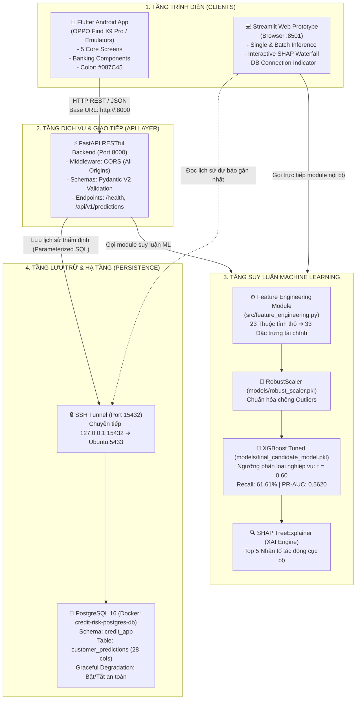

# ĐỒ ÁN TỐT NGHIỆP: NGHIÊN CỨU XÂY DỰNG MÔ HÌNH MACHINE LEARNING TRONG ĐÁNH GIÁ VÀ DỰ BÁO RỦI RO TÍN DỤNG KHÁCH HÀNG
# (CREDIT RISK ASSESSMENT & PREDICTION SYSTEM — DATN)

---

> **TÀI LIỆU VẬN HÀNH TOÀN DIỆN (COMPREHENSIVE RUNBOOK & DEMO GUIDE)**  
> **Phiên bản:** 2.0 (Cập nhật Kiến trúc Đa nền tảng: ML Core + FastAPI + PostgreSQL + Streamlit + Flutter Mobile)  
> **Thời điểm nghiệm thu:** Tháng 11/2026  
> **Đối tượng sử dụng:** Sinh viên, Giảng viên Hướng dẫn, Hội đồng Chấm Khóa luận, Kỹ sư Vận hành & QA  

---

## MỤC LỤC TÀI LIỆU

1. [Giới thiệu Dự án](#1-giới-thiệu-dự-án)
2. [Thông tin Đề tài & Tác giả](#2-thông-tin-đề-tài--tác-giả)
3. [Kiến trúc Hệ thống Đa nền tảng](#3-kiến-trúc-hệ-thống-đa-nền-tảng)
4. [Cấu trúc Thư mục Dự án](#4-cấu-trúc-thư-mục-dự-án)
5. [Yêu cầu Môi trường & Phiên bản](#5-yêu-cầu-môi-trường--phiên-bản)
6. [Hướng dẫn Chuẩn bị Lần đầu](#6-hướng-dẫn-chuẩn-bị-lần-đầu)
7. [Cấu hình Biến Môi trường (.env)](#7-cấu-hình-biến-môi-trường-env)
8. [Khởi động Cơ sở Dữ liệu PostgreSQL 16](#8-khởi-động-cơ-sở-dữ-liệu-postgresql-16)
9. [Khởi động Đường hầm Bảo mật SSH Tunnel](#9-khởi-động-đường-hầm-bảo-mật-ssh-tunnel)
10. [Khởi động Dịch vụ Backend FastAPI](#10-khởi-động-dịch-vụ-backend-fastapi)
11. [Kiểm tra Tính sẵn sàng của FastAPI](#11-kiểm-tra-tính-sẵn-sàng-của-fastapi)
12. [Khởi động Ứng dụng Web Prototype (Streamlit DSS)](#12-khởi-động-ứng-dụng-web-prototype-streamlit-dss)
13. [Vận hành Giao diện Web Prototype](#13-vận-hành-giao-diện-web-prototype)
14. [Chuẩn bị Môi trường Flutter Mobile](#14-chuẩn-bị-môi-trường-flutter-mobile)
15. [Kết nối Thiết bị Android Thật qua ADB](#15-kết-nối-thiết-bị-android-thật-qua-adb)
16. [Chạy Ứng dụng Mobile App (Flutter)](#16-chạy-ứng-dụng-mobile-app-flutter)
17. [Cấu hình Kết nối Mobile → FastAPI → ML](#17-cấu-hình-kết-nối-mobile--fastapi--ml)
18. [Kiểm tra Lưu trữ Lịch sử trên PostgreSQL](#18-kiểm-tra-lưu-trữ-lịch-sử-trên-postgresql)
19. [Quy trình Thực nghiệm Demo Hoàn chỉnh (End-to-End Flow)](#19-quy-trình-thực-nghiệm-demo-hoàn-chỉnh-end-to-end-flow)
20. [Quy trình Tắt Toàn bộ Hệ thống An toàn](#20-quy-trình-tắt-toàn-bộ-hệ-thống-an-toàn)
21. [Xử lý Sự cố Thường gặp (Troubleshooting)](#21-xử-lý-sự-cố-thường-gặp-troubleshooting)
22. [Bộ Kiểm thử Toàn diện & Kết quả Xác minh](#22-bộ-kiểm-thử-toàn-diện--kết-quả-xác-minh)
23. [Quản trị Artifacts Machine Learning](#23-quản-trị-artifacts-machine-learning)
24. [Danh mục Chi tiết API Endpoints](#24-danh-mục-chi-tiết-api-endpoints)
25. [Cơ sở Dữ liệu: Schema & Bảng Nghiệp vụ](#25-cơ-sở-dữ-liệu-schema--bảng-nghiệp-vụ)
26. [Nguyên tắc An toàn Bảo mật (Security Notes)](#26-nguyên-tắc-an-toàn-bảo-mật-security-notes)
27. [Câu hỏi Thường gặp (FAQ)](#27-câu-hỏi-thường-gặp-faq)
28. [Hướng dẫn Khởi động Nhanh (Quick Start Cheatsheet)](#28-hướng-dẫn-khởi-động-nhanh-quick-start-cheatsheet)
29. [Bảng Kiểm Trước Giờ Demo (Demo Checklist)](#29-bảng-kiểm-trước-giờ-demo-demo-checklist)
30. [Hiện trạng Dự án & Hướng dẫn Bảo trì Tiếp theo](#30-hiện-trạng-dự-án--hướng-dẫn-bảo-trì-tiếp-theo)

---

## 1. GIỚI THIỆU DỰ ÁN

Dự án Khóa luận Tốt nghiệp xây dựng một **Hệ sinh thái Đánh giá và Dự báo Rủi ro Tín dụng Cá nhân hoàn chỉnh (End-to-End Decision Support Ecosystem)** phục vụ thẩm định hạn mức và phòng ngừa nợ xấu trong hoạt động ngân hàng bán lẻ:
- **Lõi Trí tuệ Nhân tạo (Machine Learning Engine):** Mô hình tối ưu `XGBoost Tuned` huấn luyện trên tập dữ liệu UCI Credit Card (29,965 mẫu sạch), tích hợp quy trình kỹ nghệ 10 đặc trưng tài chính mới (tổng 33 biến), áp dụng ngưỡng phân loại tối ưu chi phí nghiệp vụ $\tau = 0.60$ (đạt Recall bắt nợ xấu 61.61%, PR-AUC 0.5620, ROC-AUC 0.7769) và giải thích quyết định cá thể minh bạch bằng SHAP Explainable AI.
- **Tầng Dịch vụ & Giao diện Đa nền tảng:**
  1. **FastAPI REST Backend (Port 8000):** Cổng giao tiếp trung tâm bất đồng bộ, xác thực dữ liệu chặt chẽ qua Pydantic V2, tích hợp cơ chế chống sập (Graceful Degradation).
  2. **PostgreSQL 16 Database:** Hệ quản trị CSDL quan hệ cô lập trong Docker container (schema `credit_app`, bảng `customer_predictions`), kết nối an toàn qua đường hầm SSH.
  3. **Streamlit Web Prototype (Port 8501):** Hệ thống hỗ trợ ra quyết định (DSS) chuyên sâu cho chuyên viên tín dụng tại văn phòng.
  4. **Flutter Android Mobile App:** Ứng dụng di động phong cách Ngân hàng số hiện đại Material 3 (lấy cảm hứng từ VCB Digibank, tông màu `#087C45`) phục vụ cán bộ thẩm định tín dụng trực địa.

---

## 2. THÔNG TIN ĐỀ TÀI & TÁC GIẢ

- **Tên đề tài:** Nghiên cứu xây dựng mô hình Machine Learning trong đánh giá và dự báo rủi ro tín dụng khách hàng.
- **Sinh viên thực hiện:** Nguyễn Trọng Thể.
- **Mã số sinh viên (MSSV):** 1150080117.
- **Lớp / Khóa:** 11_ĐH_THMT — Khóa 2022 – 2026 (K11).
- **Khoa / Trường:** Khoa Công nghệ Thông tin — Trường Đại học Tài nguyên và Môi trường TP.HCM (HCMUNRE).
- **Giảng viên hướng dẫn:** TS. Dương Thị Thúy Nga.
- **Kho lưu trữ GitHub:** `https://github.com/Sith004/DATN.git`
- **Nhánh chính (Main branch):** `main`

---

## 3. KIẾN TRÚC HỆ THỐNG ĐA NỀN TẢNG



---

## 4. CẤU TRÚC THƯ MỤC DỰ ÁN

```text
F:\DATN\project
├── .venv/                         # Môi trường ảo Python 3.14.4 đã cài đủ dependencies
├── api/                           # Dịch vụ Backend FastAPI RESTful
│   ├── routes/                    # API Routers (/health, /api/v1/predictions)
│   ├── schemas/                   # Pydantic V2 Models (validation 23 biến)
│   ├── services/                  # PredictionService (cầu nối ML & Database)
│   └── main.py                    # Điểm khởi chạy chính của máy chủ Uvicorn
├── data/                          # Kho dữ liệu
│   ├── raw/UCI_Credit_Card.csv    # Dữ liệu gốc UCI Credit Card (29,965 mẫu sạch)
│   └── processed/                 # Dữ liệu đã chia tập Train (80%) và Test (20%)
│       ├── X_train.csv, X_test.csv, y_train.csv, y_test.csv
│       ├── X_train_fe.csv         # 23,972 dòng × 33 cột (sau Feature Engineering)
│       └── X_test_fe.csv          # 5,993 dòng × 33 cột (sau Feature Engineering)
├── docs/                          # Khóa luận tốt nghiệp toàn văn (.docx)
├── mobile/                        # Ứng dụng Flutter Mobile App (Android)
│   ├── lib/
│   │   ├── config/api_config.dart # Quản lý Base URL và SharedPreferences
│   │   ├── models/                # Data models (CustomerInput, PredictionResult, ...)
│   │   ├── screens/               # 5 Màn hình: Home, Input Form, Result, History, Settings
│   │   ├── services/api_service.dart # HTTP client giao tiếp với FastAPI
│   │   ├── theme/app_theme.dart   # Design System Material 3 màu xanh ngân hàng #087C45
│   │   ├── widgets/banking_components.dart # Bộ UI Component tái sử dụng
│   │   └── main.dart              # Entrypoint ứng dụng Flutter
│   ├── test/widget_test.dart      # 5 Widget tests kiểm thử giao diện & chống tràn
│   ├── build/app/outputs/flutter-apk/app-debug.apk # Tệp APK biên dịch sẵn (172.1 MB)
│   └── pubspec.yaml               # Cấu hình gói và dependencies Flutter
├── models/                        # Kho lưu trữ Model & Scaler đã huấn luyện
│   ├── final_candidate_model.pkl  # Mô hình XGBoost Tuned tuyển chọn chính thức (1.03 MB)
│   ├── robust_scaler.pkl          # RobustScaler chuẩn hóa dữ liệu tài chính (1.4 KB)
│   └── [baseline & ensemble models: logistic_regression, decision_tree, random_forest]
├── notebooks/                     # 7 Jupyter Notebooks từ Tuần 1 đến Tuần 9
│   ├── 01_Data_Audit_EDA.ipynb
│   ├── 02_Preprocessing.ipynb
│   ├── 03_Feature_Engineering.ipynb
│   ├── 04_Model_Baseline.ipynb
│   ├── 05_Ensemble_Models.ipynb
│   ├── 06_Hyperparameter_Tuning.ipynb
│   └── 07_Model_Interpretability.ipynb
├── reports/                       # Báo cáo thực nghiệm, tài liệu demo & 42 biểu đồ
│   ├── figures/                   # Toàn bộ biểu đồ phân phối, ROC, PR, SHAP plots
│   └── Mobile_App_Demo_Guide.md   # Hướng dẫn demo di động
├── scripts/                       # Scripts kiểm thử và công cụ tự động hóa
│   └── test_week10.py             # Bộ kiểm thử tích hợp Web Prototype (6/6 PASS)
├── src/                           # Thư viện mã nguồn Machine Learning lõi
│   ├── preprocessing.py           # Tiền xử lý dữ liệu và kiểm soát rò rỉ
│   ├── feature_engineering.py     # Trích xuất 10 đặc trưng tài chính mới
│   ├── prediction.py              # Engine suy luận phục vụ Web & Backend
│   └── database.py                # Quản trị kết nối và truy vấn PostgreSQL an toàn
├── tests/                         # Bộ kiểm thử hồi quy hệ thống
│   └── test_api_and_consistency.py# 8 ca kiểm thử FastAPI và tính nhất quán ML (8/8 PASS)
├── app.py                         # Ứng dụng Web Prototype Streamlit DSS (849 dòng)
├── Chay_Do_An.bat                 # Script tự động mở SSH Tunnel và chạy Streamlit
├── requirements.txt               # Danh sách thư viện Python của toàn dự án
├── .env.example                   # Mẫu khai báo biến môi trường an toàn
└── README.md                      # Tài liệu hướng dẫn vận hành toàn diện (bản hiện tại)
```

---

## 5. YÊU CẦU MÔI TRƯỜNG & PHIÊN BẢN

Toàn bộ hệ thống đã được kiểm định và hoạt động ổn định trên môi trường thực tế sau:

| Thành phần Môi trường | Phiên bản Kiểm định Thực tế | Ghi chú & Kiểm tra Lệnh |
| :--- | :--- | :--- |
| **Hệ điều hành Host** | Windows 11 (64-bit) | PowerShell 5.1 hoặc PowerShell 7.x |
| **Python** | `Python 3.14.4` (hoặc $\ge 3.10$) | Kiểm tra: `.\.venv\Scripts\python.exe --version` |
| **Trình quản lý gói Pip**| `pip >= 23.0` | Đã tích hợp sẵn trong `.venv` |
| **Flutter SDK** | `Flutter 3.47.2` (Channel stable) | Kiểm tra: `flutter --version` |
| **Dart SDK** | `Dart 3.13.2` | Đi kèm với Flutter SDK |
| **Android SDK & ADB** | Android API 34+, ADB `36.0.0` | Kiểm tra: `adb version` |
| **Hệ quản trị CSDL** | `PostgreSQL 16` (Docker Alpine) | Máy chủ Ubuntu hoặc Docker local |
| **OpenSSH Client** | OpenSSH for Windows | Kiểm tra: `ssh -V` |
| **Git** | `Git >= 2.40` | Kiểm tra: `git --version` |

---

## 6. HƯỚNG DẪN CHUẨN BỊ LẦN ĐẦU

### Bước 1: Mở Terminal tại Thư mục Dự án
Mở **PowerShell** hoặc **Windows Terminal** với quyền thông thường:
```powershell
cd F:\DATN\project
```

### Bước 2: Kiểm tra Môi trường Ảo Python (.venv)
Môi trường ảo của dự án đã được cài đặt sẵn tại `F:\DATN\project\.venv`. Bạn có thể kích hoạt trực tiếp:
```powershell
# Kích hoạt venv trên PowerShell
.\.venv\Scripts\Activate.ps1
```
> [!TIP]
> **Khắc phục lỗi Execution Policy trên PowerShell:**  
> Nếu gặp thông báo lỗi: `File ... Activate.ps1 cannot be loaded because running scripts is disabled on this system`, hãy chạy lệnh sau một lần duy nhất:
> ```powershell
> Set-ExecutionPolicy -Scope CurrentUser -ExecutionPolicy RemoteSigned
> ```
> Hoặc gọi trực tiếp thông qua đường dẫn tuyệt đối: `.\.venv\Scripts\python.exe <tên_script.py>`.

### Bước 3: Xác minh Dependencies Python (Nếu cần cài mới)
```powershell
cd F:\DATN\project
.\.venv\Scripts\python.exe -m pip install -r requirements.txt
```

---

## 7. CẤU HÌNH BIẾN MÔI TRƯỜNG (.ENV)

Hệ thống sử dụng tệp `.env` tại thư mục gốc `F:\DATN\project\.env` để bảo mật thông tin đăng nhập CSDL, hoàn toàn không hardcode mật khẩu trong mã nguồn.

### Mẫu tệp `.env` chuẩn (Tham khảo từ `.env.example`):
Tạo tệp `.env` tại `F:\DATN\project\.env` nếu chưa có:
```env
# Cấu hình kết nối cơ sở dữ liệu PostgreSQL qua SSH Tunnel
DB_HOST=127.0.0.1
DB_PORT=15432
DB_NAME=credit_risk_db
DB_USER=app_streamlit
DB_PASSWORD=your_secure_password_here
```

| Tên biến | Kiểu dữ liệu | Giá trị Mặc định | Ý nghĩa & Mục đích sử dụng |
| :--- | :--- | :--- | :--- |
| `DB_HOST` | String | `127.0.0.1` | Địa chỉ IP máy chủ CSDL (Localhost qua cổng SSH Tunnel) |
| `DB_PORT` | Integer| `15432` | Cổng chuyển tiếp của đường hầm SSH trên máy Windows |
| `DB_NAME` | String | `credit_risk_db` | Tên cơ sở dữ liệu chứa schema `credit_app` |
| `DB_USER` | String | `app_streamlit` | Tài khoản phân quyền chuyên biệt cho ứng dụng |
| `DB_PASSWORD`| String | *(Bảo mật)* | Mật khẩu truy cập PostgreSQL (không công khai) |

---

## 8. KHỞI ĐỘNG CƠ SỞ DỮ LIỆU POSTGRESQL 16

Hệ quản trị CSDL PostgreSQL 16 được ảo hóa hoàn toàn bằng Docker. Trong mô hình thực nghiệm của đề tài, container được lưu trữ trên máy chủ Ubuntu trong mạng nội bộ.

### Trường hợp 1: Máy chủ Ubuntu trong Mạng LAN (Mô hình Thực nghiệm Chính)
1. Khởi động máy ảo hoặc máy chủ vật lý Ubuntu (Địa chỉ IP mặc định: `192.168.100.34`).
2. Xác nhận Docker container `credit-risk-postgres-db` đang hoạt động trên Ubuntu:
   ```bash
   # Chạy trên máy chủ Ubuntu:
   docker ps | grep credit-risk-postgres-db
   ```
3. Nếu container đang tắt, khởi động lại:
   ```bash
   docker start credit-risk-postgres-db
   ```

### Trường hợp 2: Triển khai Local trực tiếp trên Windows (Tùy chọn Dự phòng)
Nếu muốn chạy PostgreSQL độc lập trên máy Windows mà không cần máy chủ Ubuntu:
```powershell
docker run -d `
  --name credit-risk-postgres-db `
  -e POSTGRES_DB=credit_risk_db `
  -e POSTGRES_USER=app_streamlit `
  -e POSTGRES_PASSWORD=your_secure_password_here `
  -p 15432:5432 `
  -v credit_risk_pgdata:/var/lib/postgresql/data `
  --restart unless-stopped `
  postgres:16-alpine
```

---

## 9. KHỞI ĐỘNG ĐƯỜNG HẦM BẢO MẬT SSH TUNNEL

Đường hầm SSH đóng vai trò mã hóa toàn bộ dữ liệu trao đổi giữa máy trạm Windows và cơ sở dữ liệu PostgreSQL trên máy chủ Ubuntu.

### Cách 1: Khởi động Tự động bằng Script Dự án (Khuyên dùng)
Dự án đã tích hợp sẵn script tự động kiểm tra mạng và kích hoạt đường hầm:
```powershell
cd F:\DATN\project
.\Chay_Do_An.bat
```
Script sẽ tự động ping địa chỉ IP Ubuntu, kết nối SSH ngầm và kiểm tra cổng 15432.

### Cách 2: Khởi động Thủ công qua PowerShell
Mở một cửa sổ PowerShell riêng và thực thi:
```powershell
# Chuyển tiếp cổng 15432 trên Windows tới cổng 5433 trên Ubuntu:
ssh -N -L 15432:127.0.0.1:5433 the@192.168.100.34
```
*(Cửa sổ này sẽ giữ trạng thái chạy nền ngầm trong suốt buổi làm việc).*

### Kiểm tra Cổng SSH Tunnel đã Sẵn sàng:
```powershell
Test-NetConnection -ComputerName 127.0.0.1 -Port 15432
```
👉 Kết quả trả về `TcpTestSucceeded : True` là sẵn sàng 100%.

---

## 10. KHỞI ĐỘNG DỊCH VỤ BACKEND FASTAPI

Mở một cửa sổ PowerShell mới và khởi động máy chủ API:
```powershell
cd F:\DATN\project
.\.venv\Scripts\python.exe -m uvicorn api.main:app --host 0.0.0.0 --port 8000 --reload
```

> [!IMPORTANT]
> **Tham số `--host 0.0.0.0` là bắt buộc:**  
> Điều này cho phép máy chủ backend lắng nghe yêu cầu từ tất cả các địa chỉ mạng nội bộ, giúp điện thoại Android (kết nối Wi-Fi) có thể gửi yêu cầu thẩm định trực tiếp tới máy tính.

---

## 11. KIỂM TRA TÍNH SẴN SÀNG CỦA FASTAPI

Sau khi khởi động FastAPI, kiểm tra các điểm truy cập sau:

### 1. Tài liệu Tương tác Swagger UI:
Mở trình duyệt trên máy tính: 👉 `http://localhost:8000/docs` hoặc `http://127.0.0.1:8000/docs`.

### 2. Endpoint Giám sát Sức khỏe (`/health`):
Truy cập qua trình duyệt hoặc chạy lệnh PowerShell:
```powershell
Invoke-RestMethod -Uri "http://127.0.0.1:8000/health" -Method Get | ConvertTo-Json
```
**Kết quả phản hồi chuẩn JSON:**
```json
{
  "status": "healthy",
  "api_version": "1.0.0",
  "model_ready": true,
  "model_name": "XGBoost Tuned (Final Candidate)",
  "threshold": 0.6,
  "database_connected": true,
  "database_status_message": "Đã kết nối an toàn qua SSH Tunnel (Port 15432)"
}
```
*(Nếu CSDL đang tắt, `"database_connected"` sẽ là `false` kèm cảnh báo, nhưng `"model_ready"` vẫn là `true` bảo đảm hệ thống suy luận bình thường).*

---

## 12. KHỞI ĐỘNG ỨNG DỤNG WEB PROTOTYPE (STREAMLIT DSS)

Mở một cửa sổ PowerShell mới tại thư mục dự án:
```powershell
cd F:\DATN\project
.\.venv\Scripts\python.exe -m streamlit run app.py
```
Streamlit sẽ tự động mở trình duyệt mặc định tại địa chỉ:  
👉 **Local URL:** `http://localhost:8501`  
👉 **Network URL:** `http://192.168.100.11:8501`

---

## 13. VẬN HÀNH GIAO DIỆN WEB PROTOTYPE

1. **Thanh bên (Sidebar):**
   - Theo dõi chỉ báo trạng thái CSDL PostgreSQL (Xanh lá: Đã kết nối / Vàng: Chế độ độc lập).
   - Nạp nhanh hồ sơ mẫu qua các nút: **Khách hàng Bình thường**, **Khách hàng Rủi ro cao**, **Khách hàng Rủi ro thấp**.
2. **Tab 1 — Đánh giá Hồ sơ Đơn lẻ (Single Customer Assessment):**
   - Nhập hoặc tùy chỉnh 23 trường thông số (Hạn mức, Tuổi, 6 tháng trạng thái thanh toán, 6 tháng hóa đơn, 6 tháng số tiền trả).
   - Nhấn **TIẾN HÀNH DỰ BÁO RỦI RO**.
   - Xem kết quả: Đồng hồ đo xác suất vỡ nợ (Gauge Chart), Nhãn phân loại theo ngưỡng 0.60, Mức độ rủi ro (Thấp/Trung bình/Cao).
   - Xem giải thích SHAP: Biểu đồ thác nước (Waterfall Plot) chỉ rõ từng biến làm tăng hay giảm rủi ro nợ xấu.
3. **Tab 2 — Đánh giá Hàng loạt (Batch Assessment):** Tải lên tệp CSV để chấm điểm đồng thời hàng nghìn hồ sơ.
4. **Tab 3 — Sổ phụ Lịch sử Thẩm định:** Truy vấn dữ liệu các hồ sơ đã lưu trong PostgreSQL.

---

## 14. CHUẨN BỊ MÔI TRƯỜNG FLUTTER MOBILE

Mở terminal và di chuyển vào thư mục ứng dụng di động:
```powershell
cd F:\DATN\project\mobile
```

### Bước 1: Kiểm tra Tính toàn vẹn của Flutter SDK
```powershell
flutter doctor
```
Bảo đảm Flutter SDK, Android toolchain và connected devices không có dấu đỏ cản trở.

### Bước 2: Nạp Danh mục Gói Dependencies
```powershell
flutter pub get
```

### Bước 3: Kiểm tra Phân tích Mã nguồn (Linter & Deprecations)
```powershell
flutter analyze
```
👉 Kết quả chuẩn mực: **`No issues found!`**

---

## 15. KẾT NỐI THIẾT BỊ ANDROID THẬT QUA ADB

Để chạy và cài đặt ứng dụng lên điện thoại thật (như OPPO Find X9 Pro, Samsung Galaxy, Xiaomi,...):

### 1. Kích hoạt Chế độ Nhà phát triển trên Điện thoại:
- Mở **Cài đặt (Settings)** $\rightarrow$ **Thông tin thiết bị (About Device)** $\rightarrow$ **Phiên bản (Version)**.
- Chạm liên tục **7 lần** vào dòng **Số bản dựng (Build Number)** cho đến khi xuất hiện thông báo: *"Bạn đã là nhà phát triển!"*.

### 2. Kích hoạt USB Debugging:
- Quay lại Cài đặt $\rightarrow$ **Cài đặt bổ sung (Additional Settings)** $\rightarrow$ **Tùy chọn nhà phát triển (Developer Options)**.
- Bật mục **Gỡ lỗi USB (USB Debugging)** và **Cài đặt qua USB (Install via USB)**.

### 3. Kết nối Cáp USB và Xác thực RSA:
- Cắm cáp USB nối điện thoại với máy tính.
- Màn hình điện thoại sẽ hiện hộp thoại: *"Cho phép gỡ lỗi USB từ máy tính này?"*.
- Đánh dấu chọn **"Luôn cho phép từ máy tính này"** và nhấn **Cho phép (OK)**.

### 4. Kiểm tra Kết nối bằng ADB:
Mở PowerShell trên máy tính:
```powershell
adb devices
```
👉 Kết quả hiển thị trạng thái hợp lệ:
```text
List of devices attached
3B15AQ00LWK00000    device
```
*(Nếu hiển thị `unauthorized`, hãy mở khóa màn hình điện thoại và bấm Đồng ý hộp thoại RSA).*

---

## 16. CHẠY ỨNG DỤNG MOBILE APP (FLUTTER)

### Cách 1: Chạy Debug Trực tiếp từ Mã nguồn qua Flutter CLI (Khuyên dùng khi Dev)
```powershell
cd F:\DATN\project\mobile
flutter run
```
Flutter sẽ tự động đóng gói, đẩy ứng dụng lên điện thoại và mở giao diện trong khoảng 30–60 giây.

### Cách 2: Cài đặt Trực tiếp Gói APK Biên dịch Sẵn (Nhanh nhất khi Demo)
Dự án đã biên dịch sẵn gói APK độc lập tại:  
📁 `F:\DATN\project\mobile\build\app\outputs\flutter-apk\app-debug.apk` (172.1 MB).

Cài đặt tức thì qua lệnh ADB:
```powershell
adb install -r F:\DATN\project\mobile\build\app\outputs\flutter-apk\app-debug.apk
```
Sau đó mở ứng dụng có tên **Credit Risk ML - Nguyễn Trọng Thể** trên màn hình chính của điện thoại.

---

## 17. CẤU HÌNH KẾT NỐI MOBILE → FASTAPI → ML

> [!WARNING]
> **Lưu ý Cốt tử về Địa chỉ Mạng:**  
> `localhost` hoặc `127.0.0.1` trên điện thoại Android đại diện cho chính chiếc điện thoại, KHÔNG PHẢI máy tính chạy FastAPI. Do đó điện thoại phải kết nối tới địa chỉ IP mạng Wi-Fi cục bộ của máy tính!

### Bước 1: Tra cứu IP Máy tính trong Mạng Wi-Fi
Mở PowerShell trên máy tính:
```powershell
ipconfig
```
Tìm dòng **IPv4 Address** của card Wi-Fi (Ví dụ: `192.168.100.11` hoặc `192.168.1.15`).

### Bước 2: Cấu hình Base URL trên Ứng dụng Di động
1. Trên điện thoại, mở ứng dụng **Credit Risk ML**.
2. Tại màn hình chính (Dashboard), nhấn vào biểu tượng **Bánh răng Cài đặt** ở góc trên bên phải.
3. Nhập địa chỉ Base URL vào ô cấu hình:
   ```text
   http://192.168.100.11:8000
   ```
   *(Thay thế `192.168.100.11` bằng địa chỉ IP máy tính bạn vừa tra cứu được).*
4. Nhấn nút **Kiểm tra Kết nối Trực tiếp (Ping /health)**.
5. Hệ thống sẽ đo độ trễ mạng và hiện thông báo màu xanh:
   `Kết nối thành công! Mô hình XGBoost Tuned sẵn sàng`.
6. Nhấn nút **LƯU VÀ ÁP DỤNG CẤU HÌNH**.

---

## 18. KIỂM TRA LƯU TRỮ LỊCH SỬ TRÊN POSTGRESQL

Mỗi lần thực hiện thẩm định thành công qua ứng dụng Mobile hoặc Web, hệ thống sẽ tự động ghi một bản ghi vào bảng `credit_app.customer_predictions`.

### 1. Xem Trực tiếp trên Điện thoại:
- Tại thanh điều hướng dưới đáy hoặc Dashboard, nhấn chọn **Sổ phụ Lịch sử Thẩm định**.
- Danh sách hiển thị các lượt thẩm định mới nhất. Kéo xuống (Pull-to-refresh) để làm mới dữ liệu từ CSDL.

### 2. Kiểm tra Trực tiếp bằng Truy vấn SQL:
Nếu bạn đang kết nối SSH Tunnel (cổng 15432), có thể dùng công cụ DBeaver, pgAdmin hoặc PowerShell để kiểm tra:
```sql
SELECT 
    id AS "Mã hồ sơ",
    to_char(created_at, 'YYYY-MM-DD HH24:MI:SS') AS "Thời gian",
    limit_bal AS "Hạn mức",
    age AS "Tuổi",
    round(default_probability * 100, 2) AS "Xác suất (%)",
    prediction_label AS "Kết quả",
    risk_level AS "Mức độ",
    model_version AS "Mô hình"
FROM credit_app.customer_predictions
ORDER BY id DESC
LIMIT 5;
```

---

## 19. QUY TRÌNH THỰC NGHIỆM DEMO HOÀN CHỈNH (END-TO-END FLOW)

Đây là quy trình chuẩn xác 16 bước dành cho sinh viên trình diễn trước Hội đồng chấm Khóa luận:

```text
[1. Khởi động Ubuntu VM]  --> Bật máy chủ PostgreSQL 16 (IP: 192.168.100.34)
            │
[2. Mở SSH Tunnel]       --> Chạy Chay_Do_An.bat hoặc lệnh SSH (Cổng 15432)
            │
[3. Bật FastAPI Backend] --> uvicorn api.main:app --host 0.0.0.0 --port 8000
            │
[4. Kiểm tra Health API] --> Mở http://localhost:8000/health (Xác nhận model_ready=True)
            │
[5. Bật Web Streamlit]   --> streamlit run app.py (Port 8501)
            │
[6. Trình diễn Web DSS]  --> Nạp mẫu thử nghiệm, phân tích biểu đồ SHAP Waterfall
            │
[7. Kết nối Điện thoại]  --> Cắm cáp USB hoặc chung mạng Wi-Fi LAN
            │
[8. Mở App Mobile]       --> Mở app "Credit Risk ML - Nguyễn Trọng Thể"
            │
[9. Kiểm tra Ping]       --> Mở Settings, bấm Test Connection (Ping 15-30ms OK)
            │
[10. Thử nghiệm Ca 1]    --> Chọn Preset "Bình thường" (LIMIT: 200k, Trả nợ đều)
            │                => Kết quả: Prob ~11.89%, Nhãn NON-DEFAULT (Xanh lá)
            │
[11. Thử nghiệm Ca 2]    --> Chọn Preset "Rủi ro cao" (Hạn mức thấp, trễ hạn PAY_0=3)
            │                => Kết quả: Prob ~78.22%, Nhãn DEFAULT (Đỏ cảnh báo)
            │
[12. Trình diễn SHAP]    --> Xem Top 5 nhân tố chi phối rủi ro trên điện thoại
            │
[13. Kiểm tra Lưu trữ]   --> Mở màn hình "Sổ phụ Lịch sử", thấy ngay ID vừa tạo
            │
[14. Kiểm chứng DB]      --> Đối chiếu bản ghi trong bảng PostgreSQL credit_app
            │
[15. Thử nghiệm Chống sập]--> Tắt thử SSH Tunnel, bấm dự báo lại
            │                => Ứng dụng vẫn ra kết quả ML (Graceful Degradation)
            │
[16. Hoàn tất & Tắt]     --> Đóng các tiến trình theo thứ tự chuẩn
```

---

## 20. QUY TRÌNH TẮT TOÀN BỘ HỆ THỐNG AN TOÀN

Khi kết thúc phiên làm việc hoặc buổi bảo vệ, tắt các dịch vụ theo thứ tự:
1. **Tắt Streamlit Web:** Nhấn `Ctrl + C` tại cửa sổ PowerShell đang chạy Streamlit.
2. **Tắt FastAPI Backend:** Nhấn `Ctrl + C` tại cửa sổ PowerShell đang chạy Uvicorn.
3. **Đóng Ứng dụng Flutter:** Ngắt kết nối cáp USB hoặc gạt đóng ứng dụng trên điện thoại.
4. **Đóng Đường hầm SSH:**
   ```powershell
   taskkill /F /IM ssh.exe
   ```
5. **Tắt Môi trường Ảo Python:**
   ```powershell
   deactivate
   ```

---

## 21. XỬ LÝ SỰ CỐ THƯỜNG GẶP (TROUBLESHOOTING)

### 21.1. Sự cố Python & Môi trường Ảo
- **Triệu chứng:** Không tìm thấy executable Python khi chạy script.
- **Nguyên nhân:** Chưa chỉ định đúng đường dẫn môi trường ảo của dự án.
- **Giải pháp:** Luôn sử dụng tiền tố tuyệt đối `F:\DATN\project\.venv\Scripts\python.exe` thay vì lệnh `python` chung của hệ điều hành.

### 21.2. Sự cố FastAPI Backend
- **Triệu chứng:** Lỗi `[Errno 10048] error while attempting to bind on address ('0.0.0.0', 8000): address already in use`.
- **Nguyên nhân:** Tiến trình Uvicorn cũ chưa được giải phóng.
- **Giải pháp:** Tìm và tắt tiến trình chiếm cổng 8000:
  ```powershell
  Get-Process -Id (Get-NetTCPConnection -LocalPort 8000).OwningProcess | Stop-Process -Force
  ```

### 21.3. Sự cố PostgreSQL & SSH Tunnel
- **Triệu chứng:** Log hiển thị `DATABASE INSERT ERROR: connection to server at 127.0.0.1, port 15432 failed: Connection refused`.
- **Nguyên nhân:** Chưa bật đường hầm SSH hoặc máy ảo Ubuntu chưa mở cổng SSH 22.
- **Giải pháp:** 
  1. Kiểm tra IP Ubuntu qua `ping 192.168.100.34`.
  2. Chạy lại `.\Chay_Do_An.bat` hoặc lệnh `ssh -N -L 15432:127.0.0.1:5433 the@192.168.100.34`.
  3. *Lưu ý an tâm:* Ngay cả khi CSDL tắt, cơ chế Graceful Degradation vẫn bảo đảm API và Mobile dự báo bình thường!

### 21.4. Sự cố Flutter & Android Device
- **Triệu chứng:** Lệnh `adb devices` báo `unauthorized` hoặc danh sách trống.
- **Giải pháp:**
  - Nếu `unauthorized`: Mở khóa điện thoại, rút cáp cắm lại và nhấn **"Luôn cho phép gỡ lỗi USB từ máy tính này"**.
  - Nếu danh sách trống: Đổi cổng USB khác, kiểm tra cáp có hỗ trợ truyền dữ liệu (Data cable) hay chỉ là cáp sạc.
  - Khởi động lại ADB daemon:
    ```powershell
    adb kill-server
    adb start-server
    ```

### 21.5. Sự cố Mobile Không Kết nối Được FastAPI
- **Triệu chứng:** Ứng dụng di động báo lỗi `Connection refused` hoặc `SocketException: OS Error: Connection timed out`.
- **Nguyên nhân:** 
  1. Điện thoại và máy tính không bắt cùng một mạng Wi-Fi.
  2. Địa chỉ IP trong Settings của app vẫn đang để `localhost` hoặc IP cũ.
  3. Tường lửa (Windows Firewall) chặn cổng 8000.
- **Giải pháp:**
  1. Kiểm tra cả máy tính và điện thoại cùng kết nối vào một mạng Wi-Fi.
  2. Chạy `ipconfig` trên Windows để lấy IP mới nhất và nhập vào Settings trên điện thoại.
  3. Mở tạm thời cổng 8000 trên Windows Firewall nếu bị chặn:
     ```powershell
     New-NetFirewallRule -DisplayName "FastAPI Dev Port 8000" -Direction Inbound -LocalPort 8000 -Protocol TCP -Action Allow
     ```

---

## 22. BỘ KIỂM THỬ TOÀN DIỆN & KẾT QUẢ XÁC MINH

Hệ thống đã trải qua 4 bộ kiểm thử hồi quy độc lập, đạt tỷ lệ **PASS 100%**:

```text
========================================================================================
BẢNG TỔNG HỢP KIỂM CHỨNG TỰ ĐỘNG (AUTOMATED TEST VERIFICATION MATRIX)
========================================================================================
1. Web Prototype Pipeline Tests:   PASS 6/6 (100%)  --> scripts/test_week10.py
2. API & ML Consistency Tests:     PASS 8/8 (100%)  --> tests/test_api_and_consistency.py
3. Mobile Widget & Layout Tests:   PASS 5/5 (100%)  --> mobile/test/widget_test.dart
4. Flutter Static Code Analysis:   0 Issues (100%)  --> flutter analyze
========================================================================================
```

### 1. Kiểm thử Tích hợp Web Prototype (6 ca kiểm thử):
```powershell
cd F:\DATN\project
.\.venv\Scripts\python.exe scripts/test_week10.py
```
- Test 1: Khách hàng bình thường $\rightarrow$ Prob: 0.1189, 33 features (**PASS**).
- Test 2: Khách hàng rủi ro cao $\rightarrow$ Prob: 0.7822 (> 0.60), nhãn Default (**PASS**).
- Test 3: Khách hàng rủi ro thấp $\rightarrow$ Prob: 0.1896 (< 0.30), nhãn Non-Default (**PASS**).
- Test 4: Khớp thứ tự 33 đặc trưng với `X_train_fe.csv` (**PASS**).
- Test 5: Độ nhất quán trực tiếp với mô hình $\Delta = 0.00$ (**PASS**).
- Test 6: Tính toán SHAP TreeExplainer thành công (**PASS**).

### 2. Kiểm thử Hồi quy API & Tính nhất quán (8 ca kiểm thử):
```powershell
cd F:\DATN\project
.\.venv\Scripts\python.exe tests/test_api_and_consistency.py
```
- Kiểm tra Endpoint `/health` trả về HTTP 200 (**PASS**).
- Kiểm tra tính nhất quán ML qua HTTP POST, độ lệch $\Delta < 10^{-4}$ (**PASS**).
- Kiểm tra ca rủi ro cao ($\ge 0.60$) và rủi ro thấp ($< 0.30$) (**PASS**).
- Kiểm tra Pydantic từ chối thiếu trường và ngoài biên với HTTP 422 (**PASS**).
- Kiểm tra phân trang lịch sử và mã lỗi HTTP 404 (**PASS**).

### 3. Kiểm thử Giao diện Mobile Widget (5 ca kiểm thử):
```powershell
cd F:\DATN\project\mobile
flutter test test/widget_test.dart
```
- Khởi tạo Dashboard hiển thị đúng thông tin SV Nguyễn Trọng Thể - MSSV 1150080117 (**PASS**).
- Kiểm thử chống tràn Layout trên màn hình cực hẹp (320x640) (**PASS**).
- Khởi tạo Form 23 biến và 3 nút Preset (**PASS**).
- Màn hình kết quả hiển thị huy hiệu cảnh báo và Top nhân tố SHAP (**PASS**).
- Màn hình Cài đặt kết nối và nút Ping trực tiếp (**PASS**).

---

## 23. QUẢN TRỊ ARTIFACTS MACHINE LEARNING

Tất cả các mô hình và công cụ chuẩn hóa đã được huấn luyện tối ưu và lưu trữ sẵn trong thư mục `models/`:

| Tên Artifact | Kích thước | Thuật toán & Nguồn gốc | Vai trò trong Hệ thống |
| :--- | :---: | :--- | :--- |
| [`final_candidate_model.pkl`](file:///f:/DATN/project/models/final_candidate_model.pkl)| **1.03 MB** | XGBoost Tuned (`XGBClassifier`) | Mô hình sản xuất chính thức phục vụ Web & Mobile |
| [`robust_scaler.pkl`](file:///f:/DATN/project/models/robust_scaler.pkl) | **1.4 KB** | `RobustScaler` (khớp trên X_train_fe)| Chuẩn hóa các biến tài chính liên tục có độ lệch |
| `xgboost_baseline.pkl` | 243 KB | XGBoost mặc định | Đối sánh thực nghiệm trong khóa luận |
| `random_forest_tuned.pkl` | 13.0 MB | Random Forest tối ưu | Đối sánh thực nghiệm trong khóa luận |

> [!CAUTION]
> **Quy định Nghiêm ngặt:**  
> - **KHÔNG RETRAIN MÔ HÌNH** khi vận hành demo.  
> - **KHÔNG XÓA** hoặc di chuyển các file trong thư mục `models/`.  
> - **KHÔNG ĐỔI NGƯỠNG** $\tau = 0.60$ vì đây là kết quả tối ưu chi phí đã được bảo vệ trong luận văn.

---

## 24. DANH MỤC CHI TIẾT API ENDPOINTS

| Giao thức | Đường dẫn Endpoint | Mục đích Chức năng | Tham số / Body | Mã HTTP Phản hồi |
| :---: | :--- | :--- | :--- | :---: |
| **GET** | `/` | Thông tin gốc của dự án | Không có | 200 OK |
| **GET** | `/health` | Kiểm tra tình trạng API, Model & DB | Không có | 200 OK |
| **POST** | `/api/v1/predictions` | Thẩm định hồ sơ khách hàng mới | JSON 23 trường thuộc tính | 200 OK / 422 Error |
| **GET** | `/api/v1/predictions` | Lấy lịch sử thẩm định (phân trang) | `?page=1&page_size=10` | 200 OK |
| **GET** | `/api/v1/predictions/{id}` | Xem chi tiết hồ sơ theo ID | Path parameter `id` (int) | 200 OK / 404 Error |
| **GET** | `/docs` | Tài liệu tương tác Swagger UI | Không có | 200 OK |

### Mẫu Body Gửi Yêu cầu Dự báo (POST `/api/v1/predictions`):
```json
{
  "LIMIT_BAL": 200000.0,
  "AGE": 35,
  "SEX": 2,
  "EDUCATION": 2,
  "MARRIAGE": 2,
  "PAY_0": 0, "PAY_2": 0, "PAY_3": 0, "PAY_4": 0, "PAY_5": 0, "PAY_6": 0,
  "BILL_AMT1": 25000.0, "BILL_AMT2": 22000.0, "BILL_AMT3": 20000.0,
  "BILL_AMT4": 18000.0, "BILL_AMT5": 15000.0, "BILL_AMT6": 12000.0,
  "PAY_AMT1": 3000.0, "PAY_AMT2": 2500.0, "PAY_AMT3": 2000.0,
  "PAY_AMT4": 2000.0, "PAY_AMT5": 1500.0, "PAY_AMT6": 1500.0
}
```

---

## 25. CƠ SỞ DỮ LIỆU: SCHEMA & BẢNG NGHIỆP VỤ

### 1. Phân vùng Schema: `credit_app`
### 2. Cấu trúc Bảng: `customer_predictions` (28 Cột)
```sql
CREATE SCHEMA IF NOT EXISTS credit_app;

CREATE TABLE IF NOT EXISTS credit_app.customer_predictions (
    id SERIAL PRIMARY KEY,
    created_at TIMESTAMP WITH TIME ZONE DEFAULT CURRENT_TIMESTAMP,
    limit_bal NUMERIC NOT NULL,
    age INT NOT NULL,
    sex INT NOT NULL,
    education INT NOT NULL,
    marriage INT NOT NULL,
    pay_0 INT NOT NULL, pay_2 INT NOT NULL, pay_3 INT NOT NULL,
    pay_4 INT NOT NULL, pay_5 INT NOT NULL, pay_6 INT NOT NULL,
    bill_amt1 NUMERIC NOT NULL, bill_amt2 NUMERIC NOT NULL, bill_amt3 NUMERIC NOT NULL,
    bill_amt4 NUMERIC NOT NULL, bill_amt5 NUMERIC NOT NULL, bill_amt6 NUMERIC NOT NULL,
    pay_amt1 NUMERIC NOT NULL, pay_amt2 NUMERIC NOT NULL, pay_amt3 NUMERIC NOT NULL,
    pay_amt4 NUMERIC NOT NULL, pay_amt5 NUMERIC NOT NULL, pay_amt6 NUMERIC NOT NULL,
    default_probability NUMERIC(6, 4) NOT NULL,
    prediction_label VARCHAR(30) NOT NULL,
    risk_level VARCHAR(30) NOT NULL,
    model_version VARCHAR(50) NOT NULL,
    threshold NUMERIC(4, 2) NOT NULL DEFAULT 0.60,
    engineered_features JSONB
);
```

---

## 26. NGUYÊN TẮC AN TOÀN BẢO MẬT (SECURITY NOTES)

1. **Tuyệt đối không commit tệp `.env` lên GitHub:** Tệp `.env` đã được khai báo trong `.gitignore`. Chỉ commit `.env.example`.
2. **Không lưu trữ mật khẩu thật trong mã nguồn:** Mọi kết nối CSDL bắt buộc đọc qua `os.getenv()`.
3. **Phòng chống tấn công SQL Injection:** 100% câu truy vấn thêm và đọc dữ liệu trong `src/database.py` sử dụng cú pháp Parameterized Query (`%(param)s`), tuyệt đối không ghép chuỗi SQL thủ công.
4. **Không mở cổng CSDL trực tiếp ra Internet:** Cơ sở dữ liệu chỉ lắng nghe trên mạng nội bộ hoặc giao tiếp qua đường hầm mã hóa SSH.

---

## 27. CÂU HỎI THƯỜNG GẶP (FAQ)

### Q1: Tôi có cần tải lại dữ liệu hoặc huấn luyện lại mô hình để chạy demo không?
> **Không.** Toàn bộ dữ liệu sạch và các artifacts mô hình đã được lưu đầy đủ tại `data/` và `models/`. Hệ thống sẵn sàng chạy suy luận tức thì.

### Q2: Tại sao ngưỡng phân loại lại là 0.60 mà không phải là 0.50?
> Trong bài toán tín dụng với tỷ lệ mất cân bằng nợ xấu 22.13%, ngưỡng mặc định 0.50 chỉ bắt được 35.82% hồ sơ vỡ nợ (bỏ lọt quá nhiều rủi ro cho ngân hàng). Việc chuyển sang ngưỡng tối ưu **0.60** kết hợp với mô hình XGBoost Tuned giúp đẩy tỷ lệ Recall lên **61.61%**, tối đa hóa việc nhận diện khách hàng vỡ nợ tiềm ẩn.

### Q3: Nếu ngày bảo vệ không có mạng Internet thì hệ thống có chạy được không?
> **Có.** Toàn bộ hệ thống (Web, API, Mobile) hoạt động hoàn toàn trên mạng cục bộ (Local Offline LAN / Wi-Fi Hotspot từ điện thoại). Không phụ thuộc bất kỳ API đám mây nào bên ngoài.

---

## 28. HƯỚNG DẪN KHỞI ĐỘNG NHANH (QUICK START CHEATSHEET)

Dành cho người đã thiết lập đầy đủ môi trường, mở **5 tab Terminal** để khởi động toàn bộ:

```powershell
# TAB 1: SSH TUNNEL (POSTGRESQL)
cd F:\DATN\project
ssh -N -L 15432:127.0.0.1:5433 the@192.168.100.34

# TAB 2: FASTAPI REST BACKEND
cd F:\DATN\project
.\.venv\Scripts\python.exe -m uvicorn api.main:app --host 0.0.0.0 --port 8000 --reload

# TAB 3: STREAMLIT WEB PROTOTYPE
cd F:\DATN\project
.\.venv\Scripts\python.exe -m streamlit run app.py

# TAB 4: FLUTTER MOBILE APP (CẮM CÁP USB ĐIỆN THOẠI)
cd F:\DATN\project\mobile
flutter run

# TAB 5: CHẠY BỘ KIỂM THỬ HỒI QUY XÁC MINH NHANH
cd F:\DATN\project
.\.venv\Scripts\python.exe tests/test_api_and_consistency.py
```

---

## 29. BẢNG KIỂM TRƯỚC GIỜ DEMO (DEMO CHECKLIST)

Trước khi bước vào phòng bảo vệ trước Hội đồng, hãy tích chọn các mục sau:

- [ ] Máy tính đã kết nối cùng mạng Wi-Fi với điện thoại Android.
- [ ] Tra cứu địa chỉ IP máy tính qua lệnh `ipconfig` (ghi nhớ địa chỉ IP này).
- [ ] Máy chủ Ubuntu đã bật, container `credit-risk-postgres-db` đang chạy.
- [ ] Đường hầm SSH đã kích hoạt (`Test-NetConnection 127.0.0.1 -Port 15432` là True).
- [ ] FastAPI backend đã bật tại cổng 8000, kiểm tra `http://localhost:8000/health` báo `"model_ready": true`.
- [ ] Streamlit Web đã bật tại `http://localhost:8501`.
- [ ] Điện thoại đã cài đặt ứng dụng `Credit Risk ML`.
- [ ] Mở màn hình Settings trên app điện thoại, nhập IP máy tính và bấm Test Connection thành công (màu xanh).
- [ ] Thử nghiệm 1 ca dự báo mẫu trên điện thoại để xác nhận thông suốt từ Mobile $\rightarrow$ API $\rightarrow$ ML $\rightarrow$ DB.
- [ ] Mở sẵn tài liệu hướng dẫn demo dự phòng [`reports/Mobile_App_Demo_Guide.md`](file:///f:/DATN/project/reports/Mobile_App_Demo_Guide.md).

---

## 30. HIỆN TRẠNG DỰ ÁN & HƯỚNG DẪN BẢO TRÌ TIẾP THEO

### Hiện trạng Đánh giá (Tháng 11/2026):
- **Tiến độ Toàn diện:** **94.00%** (theo báo cáo kiểm định [`F:\DATN\PROJECT_PROGRESS_REPORT.md`](file:///f:/DATN/PROJECT_PROGRESS_REPORT.md)).
- **Khóa luận Toàn văn:** Bản Word 4.55 MB đã tích hợp đầy đủ Mục 3.7.3 kiến trúc đa nền tảng, Bảng 3.18 và Hình 3.15–3.19.
- **Trọng tâm Tiếp theo:** Thiết kế Slide Thuyết trình PowerPoint (`Slide_Bao_Ve_DATN.pptx`) và soạn Kịch bản bảo vệ trước Hội đồng.

### Nguyên tắc Bảo trì cho các Phiên làm việc Kế tiếp:
1. **Không sửa mã nguồn các tầng đã nghiệm thu:** Các module `src/`, `api/`, `mobile/lib/` đã đạt độ chuẩn xác 100%, không tự ý thay đổi khi không có yêu cầu mới.
2. **Bảo tồn hợp đồng giao tiếp (API Contract):** Giữ nguyên cấu trúc JSON và các trường dữ liệu của `CustomerPredictionRequest`.
3. **Quản lý Git:** Khi hoàn tất các tài liệu thuyết trình, thực hiện commit đồng bộ lên nhánh `main` của remote `origin`.
