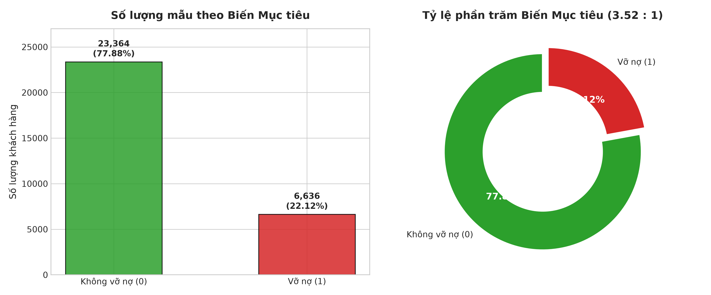
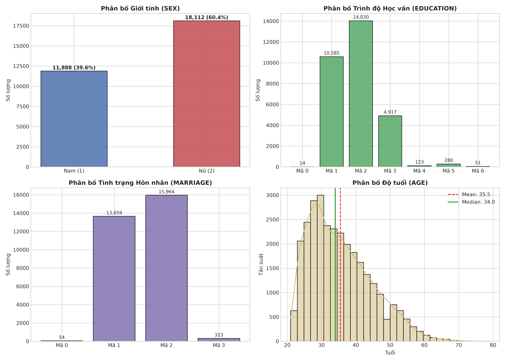
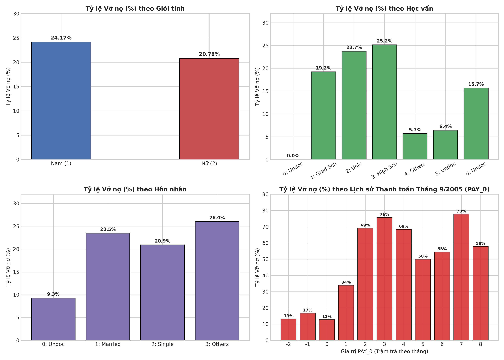
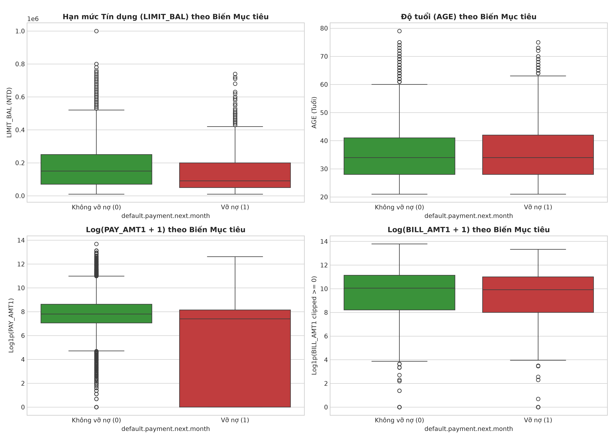
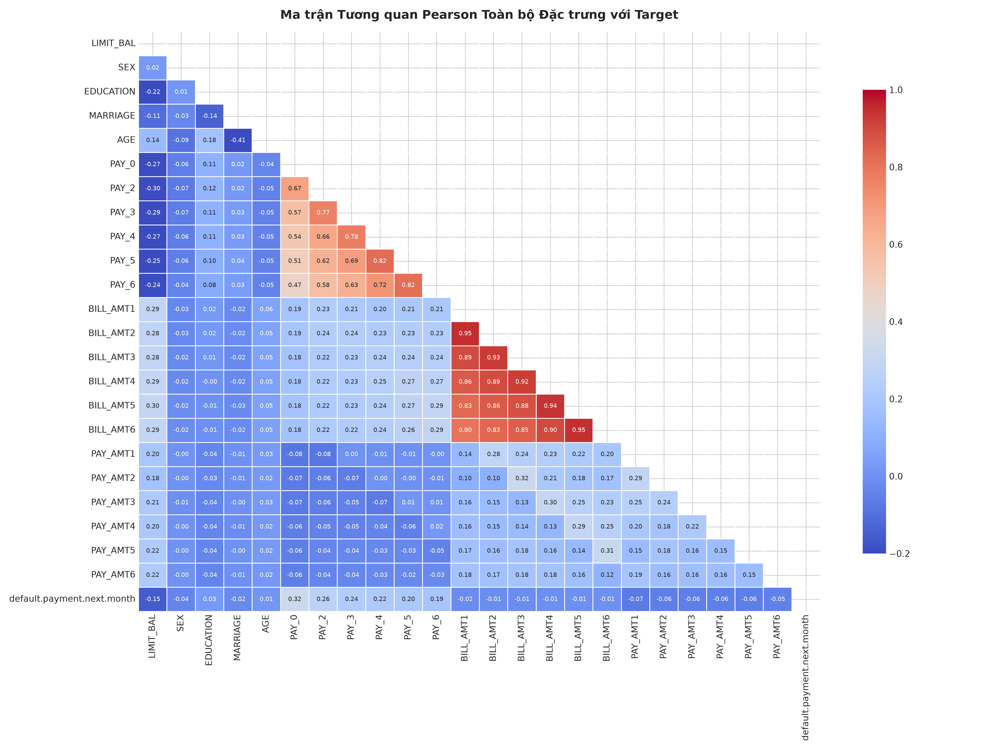
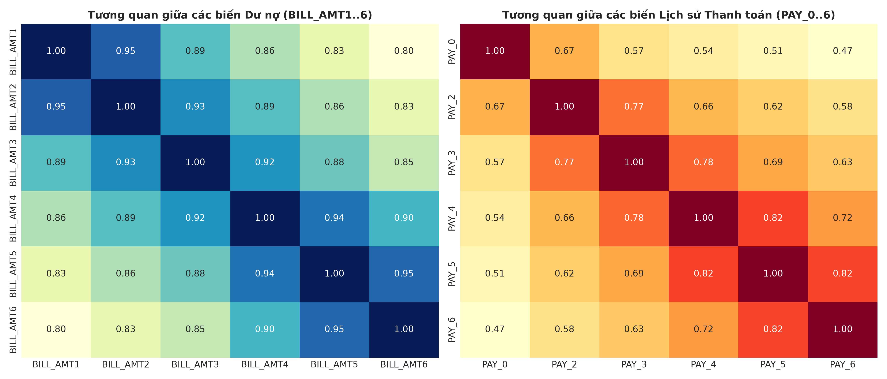

# BÁO CÁO KẾT QUẢ DATA AUDIT VÀ EDA (EXPLORATORY DATA ANALYSIS)

**Đề tài Đồ án tốt nghiệp**: "NGHIÊN CỨU XÂY DỰNG MÔ HÌNH MACHINE LEARNING TRONG ĐÁNH GIÁ VÀ DỰ BÁO RỦI RO TÍN DỤNG KHÁCH HÀNG"  
**Tập dữ liệu**: UCI Credit Card Default Dataset (`data/UCI_Credit_Card.csv`)  
**Ngày thực hiện**: Tháng 9/2026  

---

## 1. Tổng quan Đồ án tốt nghiệp & Tập dữ liệu

### 1.1. Bối cảnh Đồ án tốt nghiệp
Đánh giá rủi ro tín dụng (Credit Risk Assessment) là bài toán cốt lõi trong hoạt động của các ngân hàng và tổ chức tài chính. Việc dự báo chính xác khả năng vỡ nợ (Default) của khách hàng giúp tổ chức tối ưu hóa hạn mức tín dụng, giảm thiểu nợ xấu (Non-Performing Loans - NPL) và tăng cường năng lực quản trị rủi ro theo chuẩn mực Basel II / Basel III.

Báo cáo này đại diện cho **Giai đoạn 1** của đề cương Đồ án tốt nghiệp, tập trung toàn bộ nguồn lực vào việc **Data Audit (Kiểm soát chất lượng dữ liệu)** và **EDA (Phân tích khám phá dữ liệu)** nhằm phát hiện các đặc tính thống kê, điểm bất thường và rủi ro tiềm ẩn trước khi tiến hành xây dựng các mô hình Machine Learning.

### 1.2. Mô tả Tập dữ liệu UCI Credit Card
Tập dữ liệu chứa thông tin thanh toán nợ thẻ tín dụng của **30,000 khách hàng** tại Đài Loan trong khoảng thời gian từ **Tháng 4/2005 đến Tháng 10/2005**.

Tập dữ liệu gồm 25 thuộc tính:
- **Biến định danh**: `ID`
- **Biến nhân khẩu học**: `LIMIT_BAL`, `SEX`, `EDUCATION`, `MARRIAGE`, `AGE`
- **Lịch sử thanh toán (6 tháng)**: `PAY_0` (Tháng 9/2005) đến `PAY_6` (Tháng 4/2005)
- **Số dư hóa đơn nợ (6 tháng)**: `BILL_AMT1` đến `BILL_AMT6`
- **Số tiền đã thanh toán (6 tháng)**: `PAY_AMT1` đến `PAY_AMT6`
- **Biến mục tiêu**: `default.payment.next.month` (Nhãn vỡ nợ vào Tháng 10/2005)

---

## 2. Báo cáo Kết quả Data Audit (Tính toàn vẹn & Chất lượng Dữ liệu)

### 2.1. Cấu trúc và Dữ liệu khuyết (Missing Values)
- **Kích thước dataset**: $30,000 \text{ dòng} \times 25 \text{ cột}$.
- **Kiểu dữ liệu**: $25 / 25$ biến có kiểu dữ liệu số nguyên (`int64`).
- **Tổng số giá trị khuyết (Null/Missing)**: **0 ô khuyết** ($0.00\%$). Dataset đạt trạng thái hoàn chỉnh về mặt kỹ thuật, không cần xử lý thiếu dữ liệu cơ bản.

### 2.2. Kiểm tra Dòng trùng lặp (Duplicates Audit)
- **Trùng lặp 100% (Bao gồm ID)**: $0$ dòng.
- **Trùng lặp Đặc trưng (Bỏ qua cột ID)**: **35 dòng dữ liệu**.
  - *Đánh giá*: 35 quan sát này có toàn bộ thông tin nhân khẩu học, hạn mức, lịch sử thanh toán và hóa đơn trùng khớp hoàn toàn với mẫu khác. Việc này có thể do khách hàng đăng ký 2 tài khoản trùng thuộc tính hoặc lỗi ghi nhận trùng mẫu.
  - *Khuyến nghị*: Loại bỏ 35 dòng trùng lặp này ở bước Preprocessing để tránh gây thiên vị mẫu (sample bias).

### 2.3. Kiểm tra Mã danh mục chưa quy ước (Undocumented Categories)
Đối chiếu với tài liệu gốc của UCI Repository, phát hiện một số mã giá trị chưa được mô tả chính thức:
1. **`EDUCATION` (Trình độ học vấn)**:
   - Mô tả UCI: 1 = Graduate School, 2 = University, 3 = High School, 4 = Others.
   - Giá trị thực tế phát hiện: Mã `0` (14 mẫu), Mã `5` (280 mẫu), Mã `6` (51 mẫu).
   - Tổng cộng: **345 mẫu** ($1.15\%$).
2. **`MARRIAGE` (Tình trạng hôn nhân)**:
   - Mô tả UCI: 1 = Married, 2 = Single, 3 = Others.
   - Giá trị thực tế phát hiện: Mã `0` (**54 mẫu** ~ $0.18\%$).
3. **`PAY_0` đến `PAY_6` (Lịch sử thanh toán)**:
   - Mô tả UCI: -1 = Pay duly, 1 = Payment delay 1 month, ..., 8 = Delay 8 months.
   - Giá trị thực tế phát hiện: Mã `-2` ($2,759$ mẫu ở `PAY_0`) biểu thị tài khoản không có giao dịch/dư nợ; Mã `0` ($14,737$ mẫu ở `PAY_0`) biểu thị sử dụng tín dụng xoay vòng (revolving credit) và thanh toán tối thiểu.

### 2.4. Kiểm tra Dư nợ âm và Số tiền thanh toán bằng 0
- **Dư nợ hóa đơn âm (`BILL_AMT1..6 < 0`)**: Chiếm từ $1.97\%$ đến $2.29\%$ số mẫu qua các tháng (ví dụ: `BILL_AMT1` có 590 mẫu âm).
  - *Bản chất tài chính*: Khách hàng đã thanh toán thừa so với dư nợ hóa đơn kỳ trước hoặc được tiền hoàn/chiết khấu vào tài khoản. Đây là hiện tượng hợp lệ trong nghiệp vụ thẻ tín dụng.
- **Số tiền thanh toán bằng 0 (`PAY_AMT1..6 = 0`)**: Chiếm từ $17.50\%$ (`PAY_AMT1`) đến $23.91\%$ (`PAY_AMT6`) số mẫu.
  - *Bản chất tài chính*: Phản ánh tỷ lệ khách hàng không thực hiện bất kỳ giao dịch thanh toán nào trong kỳ.

---

## 3. Phân tích chi tiết Biến Mục tiêu (Target Distribution)

Biến mục tiêu: `default.payment.next.month` đo lường trạng thái vỡ nợ của khách hàng trong Tháng 10/2005.

| Giá trị | Ý nghĩa | Số lượng (Mẫu) | Tỷ lệ phần trăm (%) |
| :--- | :--- | :---: | :---: |
| **0** | Không vỡ nợ (Non-Default) | 23,364 | 77.88% |
| **1** | Vỡ nợ (Default) | 6,636 | 22.12% |
| **Tổng** | | **30,000** | **100.00%** |

### Đánh giá Mất cân bằng Lớp (Class Imbalance Assessment)
- **Tỷ lệ Mất cân bằng (Imbalance Ratio)**: $\frac{23,364}{6,636} \approx \mathbf{3.52 : 1}$.
- **Rủi ro ML (Accuracy Paradox)**:
  - Nếu một mô hình giả định "ngây thơ" luôn dự báo mọi khách hàng thuộc lớp 0 (Không vỡ nợ), mô hình vẫn đạt độ chính xác (Accuracy) lên tới **77.88%**.
  - Tuy nhiên, mục tiêu kinh doanh của ngân hàng là phát hiện tối đa khách hàng vỡ nợ (Lớp 1) để ngăn chặn tổn thất tài chính. Việc bỏ sót khách hàng vỡ nợ (False Negative) gây thiệt hại nghiêm trọng hơn nhiều so với việc cảnh báo nhầm khách hàng tốt (False Positive).
  - **Kết luận bắt buộc**: Trong các bước ML tiếp theo, **KHÔNG sử dụng Accuracy làm metric chính**. Phải đánh giá bằng **ROC-AUC, PR-AUC, F1-Score, Recall** và áp dụng kỹ thuật cân bằng trọng số lớp (`class_weight='balanced'`) hoặc lấy mẫu (SMOTE/Under-sampling).

---

## 4. Thống kê Mô tả và Phân tích Khám phá Dữ liệu (EDA Highlights)

### 4.1. Bảng Thống kê Mô tả Biến Số (Descriptive Statistics)

| Biến số | Mean | Std | Min | Median (Q50) | Max | Skewness | Kurtosis |
| :--- | :---: | :---: | :---: | :---: | :---: | :---: | :---: |
| **LIMIT_BAL** | 167,484.32 | 129,747.66 | 10,000.00 | 140,000.00 | 1,000,000.00 | 0.99 | 0.54 |
| **AGE** | 35.49 | 9.22 | 21.00 | 34.00 | 79.00 | 0.73 | 0.04 |
| **BILL_AMT1** | 51,223.33 | 73,635.86 | -165,580.00 | 22,381.50 | 964,511.00 | 2.66 | 9.81 |
| **BILL_AMT2** | 49,179.08 | 71,173.77 | -69,777.00 | 21,200.00 | 983,931.00 | 2.71 | 10.30 |
| **BILL_AMT3** | 47,013.15 | 69,349.39 | -157,264.00 | 20,088.50 | 1,664,089.00 | 3.09 | 19.78 |
| **BILL_AMT4** | 43,262.95 | 64,332.86 | -170,000.00 | 19,052.00 | 891,586.00 | 2.82 | 11.31 |
| **BILL_AMT5** | 40,311.40 | 60,797.16 | -81,334.00 | 18,104.50 | 927,171.00 | 2.88 | 12.31 |
| **BILL_AMT6** | 38,871.76 | 59,554.11 | -339,603.00 | 17,071.00 | 961,664.00 | 2.85 | 12.27 |
| **PAY_AMT1** | 5,663.58 | 16,563.28 | 0.00 | 2,100.00 | 873,552.00 | **14.67** | **415.25** |
| **PAY_AMT2** | 5,921.16 | 23,040.87 | 0.00 | 2,009.00 | 1,684,259.00 | **30.45** | **1641.63** |
| **PAY_AMT3** | 5,225.68 | 17,606.96 | 0.00 | 1,800.00 | 896,040.00 | **17.22** | **564.31** |
| **PAY_AMT4** | 4,826.08 | 15,666.16 | 0.00 | 1,500.00 | 621,000.00 | **12.90** | **277.33** |
| **PAY_AMT5** | 4,799.39 | 15,278.31 | 0.00 | 1,500.00 | 426,529.00 | **11.13** | **180.06** |
| **PAY_AMT6** | 5,215.50 | 17,777.47 | 0.00 | 1,500.00 | 528,666.00 | **10.64** | **167.16** |

### 4.2. Phân tích Tỷ lệ Vỡ nợ theo Nhóm Đặc trưng (Bivariate Analysis)

1. **Giới tính (`SEX`)**:
   - Nam giới (SEX=1): Tỷ lệ vỡ nợ **24.17%** (2,873 / 11,888 khách hàng).
   - Nữ giới (SEX=2): Tỷ lệ vỡ nợ **20.78%** (3,763 / 18,112 khách hàng).
   - *Nhận xét*: Khách hàng nam có rủi ro vỡ nợ cao hơn nữ giới khoảng 3.39%.
2. **Trình độ học vấn (`EDUCATION`)**:
   - Thạc sĩ/Tiến sĩ (EDUCATION=1): Tỷ lệ vỡ nợ **19.23%**.
   - Đại học (EDUCATION=2): Tỷ lệ vỡ nợ **23.73%**.
   - Phổ thông (EDUCATION=3): Tỷ lệ vỡ nợ **25.16%**.
   - *Nhận xét*: Trình độ học vấn càng cao thì tỷ lệ vỡ nợ có xu hướng giảm dần.
3. **Tình trạng hôn nhân (`MARRIAGE`)**:
   - Đã kết hôn (MARRIAGE=1): Tỷ lệ vỡ nợ **23.47%**.
   - Độc thân (MARRIAGE=2): Tỷ lệ vỡ nợ **20.93%**.
   - Khác/Ly hôn (MARRIAGE=3): Tỷ lệ vỡ nợ **26.01%**.
4. **Trạng thái Thanh toán Tháng 9/2005 (`PAY_0`) - Biến dự báo quan trọng nhất**:
   - Khi `PAY_0 <= 0` (Thanh toán đúng hạn/trả tối thiểu): Tỷ lệ vỡ nợ duy trì ở mức thấp ($12.8\% - 16.8\%$).
   - Khi `PAY_0 = 1` (Trậm trả 1 tháng): Tỷ lệ vỡ nợ tăng vọt lên **33.95%**.
   - Khi `PAY_0 = 2` (Trậm trả 2 tháng): Tỷ lệ vỡ nợ lên tới **69.14%** (1,844 / 2,667 khách hàng).

---

## 5. Phân tích Tương quan & Đa cộng tuyến (Correlation & Multicollinearity)

### 5.1. Tương quan giữa Đặc trưng và Biến Mục tiêu
Ma trận tương quan Pearson giữa 24 đặc trưng đầu vào và `default.payment.next.month`:
- `PAY_0`: $r = \mathbf{+0.325}$ (Tương quan dương mạnh nhất).
- `PAY_2`: $r = +0.264$, `PAY_3`: $r = +0.235$, `PAY_4`: $r = +0.217$.
- `LIMIT_BAL`: $r = \mathbf{-0.154}$ (Tương quan âm, hạn mức càng cao rủi ro vỡ nợ càng giảm).
- `BILL_AMT1..6`: Tương quan rất yếu ($|r| < 0.02$).

### 5.2. Đa cộng tuyến giữa các Biến Đầu vào (Multicollinearity)

Phát hiện đa cộng tuyến rất cao giữa các biến cùng nhóm:
- **Nhóm dư nợ hóa đơn (`BILL_AMT1..6`)**:
  - $r(\text{BILL\_AMT1}, \text{BILL\_AMT2}) = \mathbf{0.951}$
  - $r(\text{BILL\_AMT4}, \text{BILL\_AMT5}) = \mathbf{0.940}$
  - $r(\text{BILL\_AMT5}, \text{BILL\_AMT6}) = \mathbf{0.946}$
- **Nhóm lịch sử thanh toán (`PAY_0..6`)**: Tương quan dao động từ $r = 0.716$ đến $r = 0.820$.
- *Đánh giá rủi ro ML*: Hiện tượng đa cộng tuyến nghiêm trọng sẽ làm sai lệch hệ số ước lượng của mô hình Logistic Regression, làm tăng độ biến động (variance) và giảm tính giải thích của các thuộc tính.

---

## 6. Các vấn đề Dữ liệu Trọng yếu Đã phát hiện

1. **Rò rỉ dữ liệu (Data Leakage Audit)**:
   - Cột `ID` là mã định danh thứ tự ngẫu nhiên, hoàn toàn không có giá trị tiên đoán nghiệp vụ. Phải loại bỏ ở bước Preprocessing.
   - Các biến thời gian ghi nhận từ Tháng 4 đến Tháng 9/2005, hoàn toàn nằm trước mốc thời gian dự báo (Tháng 10/2005). Không bị rò rỉ mốc thời gian.
2. **Đa cộng tuyến nghiêm trọng (Multicollinearity)**: Các biến `BILL_AMT1..6` tương quan > 0.90 với nhau.
3. **Phân bố lệch phải & Outliers cực đại (Extreme Skewness & Outliers)**:
   - Nhóm `PAY_AMT1..6` có skewness > 10 và kurtosis > 100, chứa nhiều ngoại biệt hàng trăm nghìn NTD.
4. **Mã danh mục chưa quy ước (Undocumented Categories)**: `EDUCATION` (0, 5, 6) và `MARRIAGE` (0) chiếm tổng cộng 399 quan sát (~ 1.33%).
5. **Mất cân bằng lớp (Class Imbalance)**: Tỷ lệ 3.52 : 1 (22.12% vỡ nợ).

---

## 7. Những vấn đề cần xử lý ở bước Preprocessing (Đề xuất)

> [!IMPORTANT]
> Mục này chỉ đóng vai trò đề xuất phương án xử lý chi tiết cho Giai đoạn Preprocessing tiếp theo. Không thực hiện bất kỳ thao tác chỉnh sửa dữ liệu nào ở giai đoạn này.

### 7.1. Đề xuất Xử lý Làm sạch Dữ liệu
- **Loại bỏ cột ID**: Loại bỏ `ID` khỏi không gian đặc trưng.
- **Loại bỏ Dòng trùng lặp**: Loại bỏ 35 dòng dữ liệu trùng lặp thuộc tính khách hàng.
- **Quy chuẩn mã danh mục chưa quy ước**:
  - `EDUCATION`: Gom các mã `0, 5, 6` về mã `4 (Others)` hoặc tạo mã `0 (Unknown)`.
  - `MARRIAGE`: Gom mã `0` về mã `3 (Others)` hoặc tạo mã `0 (Unknown)`.

### 7.2. Đề xuất Kỹ thuật Đặc trưng (Feature Engineering)
Nhằm giảm bớt đa cộng tuyến và bổ sung chỉ báo tài chính giàu ý nghĩa cho mô hình ML:
- `UTILIZATION_RATE`: Tỷ lệ sử dụng hạn mức tín dụng ($\text{BILL\_AMT1} / \text{LIMIT\_BAL}$).
- `MEAN_BILL_AMT`: Dư nợ hóa đơn trung bình 6 tháng.
- `MEAN_PAY_AMT`: Số tiền thanh toán trung bình 6 tháng.
- `PAY_RATIO`: Tỷ lệ thanh toán trên dư nợ ($\text{PAY\_AMT1} / (\text{BILL\_AMT2} + 1)$).
- `MAX_PAY_DELAY`: Số tháng trậm trả tối đa ghi nhận trong 6 tháng ($\max(\text{PAY\_0..6})$).

### 7.3. Đề xuất Biến đổi Phân bố và Chuẩn hóa Dữ liệu (Scaling & Transformation)
- Áp dụng phép biến đổi phi tuyến `Log1p(x)` hoặc `Yeo-Johnson` cho nhóm `PAY_AMT` và `LIMIT_BAL` nhằm thu hẹp đuôi phân bố lệch.
- Sử dụng `RobustScaler` hoặc `StandardScaler` đối với các mô hình nhạy cảm với khoảng khoảng cách (Logistic Regression, KNN, SVM, Neural Networks).

### 7.4. Đề xuất Cân bằng Lớp và Chỉ số Đánh giá Mô hình (Class Imbalance Handling)
- Áp dụng tham số `class_weight='balanced'` hoặc kỹ thuật SMOTE trên tập Train.
- Lựa chọn **ROC-AUC** làm chỉ số tối ưu chính, kết hợp với **PR-AUC** và **F1-Score (Macro / Binary)**.
