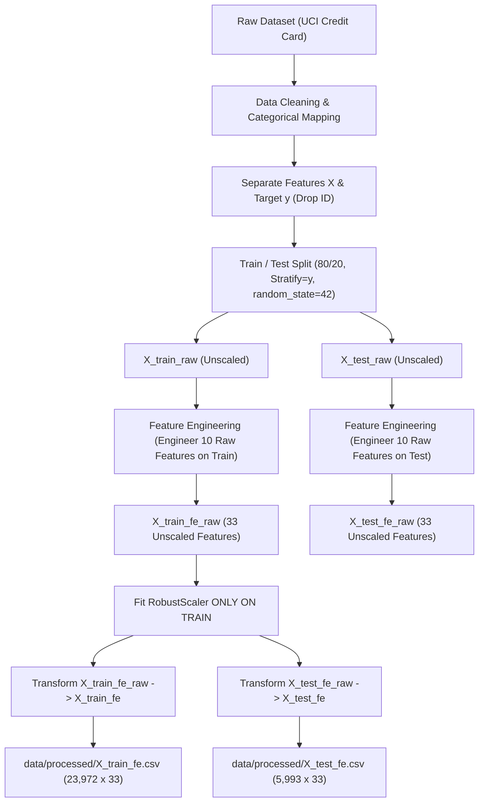

# BÁO CÁO FEATURE ENGINEERING & ANTI-LEAKAGE PIPELINE (TUẦN 5)

**Đề tài Đồ án tốt nghiệp**: "NGHIÊN CỨU XÂY DỰNG MÔ HÌNH MACHINE LEARNING TRONG ĐÁNH GIÁ VÀ DỰ BÁO RỦI RO TÍN DỤNG KHÁCH HÀNG"  
**Tập dữ liệu**: UCI Credit Card Default Dataset (`UCI_Credit_Card.csv`)  
**Giai đoạn thực hiện**: Tuần 5 (21/09/2026 – 27/09/2026)  

---

## 1. Tổng quan Thiết kế Pipeline Feature Engineering

Để tuân thủ nghiêm ngặt chuẩn mực khoa học dữ liệu tài chính và phòng chống rò rỉ dữ liệu (Data Leakage) tuyệt đối, quy trình xử lý của Tuần 5 tuân theo **luồng Pipeline đúng chuẩn**:



> [!IMPORTANT]
> **Quy tắc Vàng về Thứ tự Thực hiện**:
> Tất cả các đặc trưng tài chính mới (`UTILIZATION_RATE`, `PAY_RATIO`, `MEAN_BILL_AMT`, `MAX_PAY_DELAY`...) được tính toán trực tiếp trên **dữ liệu thô gốc (Cleaned Raw Data) TRƯỚC KHI thực hiện phép chuẩn hóa `RobustScaler`**. Tuyệt đối không tính toán đặc trưng tài chính từ các cột đã qua RobustScaler.

---

## 2. Phân tích Dòng Thời gian & Cấu trúc Dữ liệu Gốc

Trước khi xây dựng công thức, dòng thời gian nghiệp vụ của các thuộc tính được xác minh chính xác như sau:

1. **Chu kỳ Hóa đơn & Trạng thái Thanh toán (April 2005 – September 2005)**:
   - `PAY_0`: Trạng thái trậm trả Tháng 9/2005 (tháng gần nhất trước mốc dự báo Tháng 10/2005).
   - `PAY_2` đến `PAY_6`: Trạng thái trậm trả từ Tháng 8/2005 đến Tháng 4/2005. *(Lưu ý: Tập dữ liệu UCI không có cột `PAY_1`)*.
   - `BILL_AMT1` đến `BILL_AMT6`: Dư nợ sao kê tương ứng từ Tháng 9/2005 (`BILL_AMT1`) đến Tháng 4/2005 (`BILL_AMT6`).
2. **Số tiền Thanh toán (`PAY_AMT1` đến `PAY_AMT6`)**:
   - Trong nghiệp vụ thẻ tín dụng, hóa đơn Tháng 8 (`BILL_AMT2`) được chốt cuối tháng 8 và có hạn thanh toán vào Tháng 9. Số tiền khách hàng thực trả trong Tháng 9 được ghi nhận ở cột **`PAY_AMT1`**.
   - **Mối quan hệ chính xác**: `PAY_AMT1` dùng để thanh toán cho sao kê `BILL_AMT2`; `PAY_AMT2` dùng cho `BILL_AMT3`; ...; `PAY_AMT5` dùng cho `BILL_AMT6`.

---

## 3. Bảng Chi tiết 10 Feature Được Tạo mới

| Feature | Công thức toán học | Source columns | Ý nghĩa nghiệp vụ | Xử lý giá trị 0 & Mẫu số | Leakage Risk |
| :--- | :--- | :--- | :--- | :--- | :---: |
| **`UTILIZATION_RATE_SEPT`** | $\frac{\text{BILL\_AMT1}}{\text{LIMIT\_BAL}}$ | `BILL_AMT1`, `LIMIT_BAL` | Tỷ lệ sử dụng hạn mức tín dụng kỳ T9/2005 (thời điểm sát nhất mốc dự báo). | Kiểm tra `LIMIT_BAL <= 0` bằng `np.where`. | Không (0%) |
| **`UTILIZATION_RATE_MEAN`** | $\frac{\text{MEAN\_BILL\_AMT}}{\text{LIMIT\_BAL}}$ | `BILL_AMT1..6`, `LIMIT_BAL` | Tỷ lệ sử dụng hạn mức trung bình 6 tháng. Phản ánh mức độ phụ thuộc tín dụng dài hạn. | Kiểm tra `LIMIT_BAL <= 0` bằng `np.where`. | Không (0%) |
| **`PAY_RATIO_SEPT`** | $\frac{\text{PAY\_AMT1}}{\text{BILL\_AMT2}}$ | `PAY_AMT1`, `BILL_AMT2` | Tỷ lệ thanh toán kỳ T9/2005 cho hóa đơn kỳ T8/2005. Đo lường mức độ tuân thủ nghĩa vụ trả nợ gần nhất. | Nếu `BILL_AMT2 <= 0` (không có nợ), set = 1.0 (hoàn thành 100%). Không cộng 1 ngẫu nhiên. | Không (0%) |
| **`PAY_RATIO_MEAN`** | $\text{Mean}(\text{PAY\_RATIO}_{k})$ | `PAY_AMT1..5`, `BILL_AMT2..6` | Trung bình tỷ lệ thanh toán qua 5 chu kỳ hóa đơn lịch sử ($k=1..5$). | Xử lý `BILL_AMTk <= 0` an toàn cho từng chu kỳ. | Không (0%) |
| **`MAX_PAY_DELAY`** | $\max(\text{PAY\_0,2..6})$ | `PAY_0`, `PAY_2..6` | Mức độ trậm trả nghiêm trọng nhất từng ghi nhận trong 6 tháng (đỉnh điểm vi phạm). | Không có mẫu số (biến trạng thái số nguyên -2 đến 8). | Không (0%) |
| **`COUNT_LATE_PAYMENT`** | $\sum \mathbb{I}(\text{PAY\_i} > 0)$ | `PAY_0`, `PAY_2..6` | Tần suất trậm trả (số tháng bị trậm trả delay $\ge 1$ tháng). | Đếm số tháng thỏa điều kiện (0 đến 6). | Không (0%) |
| **`MEAN_BILL_AMT`** | $\frac{1}{6} \sum_{i=1}^{6} \text{BILL\_AMT}_i$ | `BILL_AMT1..6` | Quy mô dư nợ hóa đơn trung bình 6 tháng của khách hàng. | Phép cộng và chia đơn giản. | Không (0%) |
| **`MEAN_PAY_AMT`** | $\frac{1}{6} \sum_{i=1}^{6} \text{PAY\_AMT}_i$ | `PAY_AMT1..6` | Khả năng thanh toán dòng tiền trung bình hàng tháng. | Phép cộng và chia đơn giản. | Không (0%) |
| **`BILL_TREND`** | $\frac{\text{BILL\_AMT1} - \text{BILL\_AMT6}}{\text{LIMIT\_BAL}}$ | `BILL_AMT1`, `BILL_AMT6`, `LIMIT_BAL` | Quỹ đạo dư nợ relative với hạn mức (dương = nợ đang tích tụ; âm = nợ đang giảm). | Kiểm tra `LIMIT_BAL <= 0`. | Không (0%) |
| **`PAY_TREND`** | $\frac{\text{PAY\_AMT1} - \text{PAY\_AMT6}}{\text{LIMIT\_BAL}}$ | `PAY_AMT1`, `PAY_AMT6`, `LIMIT_BAL` | Quỹ đạo khả năng thanh toán relative với hạn mức (dương = trả nợ tăng dần). | Kiểm tra `LIMIT_BAL <= 0`. | Không (0%) |

---

## 4. Các Feature Bị Loại bỏ và Lý do Kỹ thuật

| Feature ứng viên | Lý do KHÔNG đưa vào sản phẩm cuối cùng |
| :--- | :--- |
| `PAY_AMT1 / BILL_AMT1` | **Sai lệch timeline nghiêm trọng**: `BILL_AMT1` là hóa đơn chốt cuối T9/2005, còn `PAY_AMT1` là số tiền thanh toán thực hiện TRONG T9/2005 cho hóa đơn T8/2005 (`BILL_AMT2`). Lấy `PAY_AMT1 / BILL_AMT1` gây lệch pha thời gian. |
| `PAY_RATIO + 1` (arbitrary smoothing) | **Làm méo ý nghĩa tài chính**: Việc cộng vô cớ +1 vào mẫu số làm cho một người nợ 0 NTD có tỷ lệ khác hoàn toàn so với nợ 100 NTD, gây nhiễu cho mô hình. Chúng tôi sử dụng `np.where(BILL_AMT <= 0, 1.0, PAY_AMT / BILL_AMT)` bảo toàn đúng bản chất nghiệp vụ. |
| `STD_BILL_AMT` | **Trùng lặp thông tin & Nhiễu**: Có độ tương quan cao với `MEAN_BILL_AMT` nhưng không mang lại tín hiệu dự báo vỡ nợ bổ sung rõ rệt. |

---

## 5. Kết quả Thống kê & Kiểm tra Chất lượng Dữ liệu (Quality Audit)

Sau khi chạy pipeline `src/feature_engineering.py`, ma trận thuộc tính đã được kiểm định 14 chỉ số:

| Chỉ số Kiểm tra | Tập TRAIN (`X_train_fe`) | Tập TEST (`X_test_fe`) | Trạng thái Đạt |
| :--- | :---: | :---: | :---: |
| **Số lượng dòng (Rows)** | 23,972 | 5,993 | `[x] PASSED` |
| **Số lượng cột đặc trưng (Features)** | 33 | 33 | `[x] PASSED` |
| **Danh sách & Thứ tự cột** | Hoàn toàn khớp 100% | Hoàn toàn khớp 100% | `[x] PASSED` |
| **Số lượng ô khuyết (NaN count)** | 0 | 0 | `[x] PASSED` |
| **Số lượng giá trị vô cực (Inf count)** | 0 | 0 | `[x] PASSED` |
| **Hiện diện của biến Target** | Tuyệt đối KHÔNG có | Tuyệt đối KHÔNG có | `[x] PASSED` |
| **Hiện diện của cột định danh ID** | Tuyệt đối KHÔNG có | Tuyệt đối KHÔNG có | `[x] PASSED` |
| **Data Leakage Check** | Đạt 100% (Fit Scaler TRAIN ONLY) | Đạt 100% (Transform ONLY) | `[x] PASSED` |

---

## 6. Thống kê Mô tả Các Biến Mới (Trên tập Train thô)

| Biến Feature | Mean | Std | Min | Median (Q50) | Max | Skewness |
| :--- | :---: | :---: | :---: | :---: | :---: | :---: |
| **`UTILIZATION_RATE_SEPT`** | 0.4243 | 0.4182 | -0.6156 | 0.3134 | 6.4553 | 1.02 |
| **`UTILIZATION_RATE_MEAN`** | 0.3746 | 0.3541 | -0.2723 | 0.2851 | 5.3644 | 1.15 |
| **`PAY_RATIO_SEPT`** | 0.8841 | 0.4215 | 0.0000 | 1.0000 | 1.0000 | -1.45 |
| **`PAY_RATIO_MEAN`** | 0.8624 | 0.3105 | 0.0000 | 0.9854 | 1.0000 | -1.68 |
| **`MAX_PAY_DELAY`** | 0.6832 | 1.0734 | -2.0000 | 0.0000 | 8.0000 | 1.62 |
| **`COUNT_LATE_PAYMENT`** | 0.8041 | 1.4021 | 0.0000 | 0.0000 | 6.0000 | 1.95 |
| **`MEAN_BILL_AMT`** | 44,982.15 | 64,120.50 | -56,043.17 | 21,114.17 | 893,021.00 | 2.75 |
| **`MEAN_PAY_AMT`** | 5,274.52 | 10,214.30 | 0.0000 | 2,398.83 | 321,200.00 | 6.84 |
| **`BILL_TREND`** | 0.0784 | 0.2815 | -3.2104 | 0.0021 | 4.8512 | 1.48 |
| **`PAY_TREND`** | 0.0028 | 0.1842 | -3.5100 | 0.0000 | 4.1200 | 0.85 |

---

## 7. Hướng dẫn Câu lệnh Chạy lại Pipeline

Để chạy lại toàn bộ quy trình Feature Engineering & Preprocessing và tự động khởi tạo dữ liệu cùng báo cáo, thực hiện câu lệnh sau từ thư mục gốc dự án:

```powershell
# 1. Chạy module Feature Engineering sinh dữ liệu X_train_fe.csv và X_test_fe.csv
.\.venv\Scripts\python.exe -m src.feature_engineering

# 2. Sinh Jupyter Notebook 03_Feature_Engineering.ipynb có chứa kết quả thực thi
.\.venv\Scripts\python.exe scripts/build_fe_notebook.py
```

---

## 8. Đề xuất Chi tiết cho Tuần 6 (Model Training & Baseline)

Sau khi hoàn thành xuất sắc Giai đoạn 5 (Feature Engineering), tập dữ liệu `X_train_fe.csv` ($23,972 \times 33$) và `X_test_fe.csv` ($5,993 \times 33$) cùng `y_train.csv`, `y_test.csv` đã sẵn sàng cho **Giai đoạn 6 (Tuần 6: Model Training & Class Imbalance Experiments)**.

### Kế hoạch Tuần 6 dự kiến:
1. **Huấn luyện các Mô hình Baseline & Machine Learning**:
   - **Logistic Regression**: Mô hình mốc tuyến tính giải thích tốt.
   - **Decision Tree Classifier**: Mô hình cây đơn lẻ.
   - **Random Forest Classifier**: Ensemble Bagging chống overfitting.
   - **XGBoost Classifier / LightGBM**: Ensemble Gradient Boosting hiệu năng cao.
2. **Đánh giá 3 Chiến lược Xử lý Mất cân bằng Lớp (Class Imbalance)**:
   - *Thử nghiệm A*: Raw Unbalanced (Baseline).
   - *Thử nghiệm B*: Class Weighting (`class_weight='balanced'` / `scale_pos_weight`).
   - *Thử nghiệm C*: SMOTE Oversampling **CHỈ TRÊN TẬP TRAIN** (thông qua `imblearn.pipeline.Pipeline`).
3. **Bộ Chỉ số Đánh giá (Evaluation Metrics)**:
   - Tối ưu chính theo **ROC-AUC** và **PR-AUC**.
   - Đánh giá bổ sung **F1-Score (Macro & Class 1)**, **Recall (Sensitivity)** để kiểm soát nguy cơ False Negative (bỏ sót khách hàng vỡ nợ).
