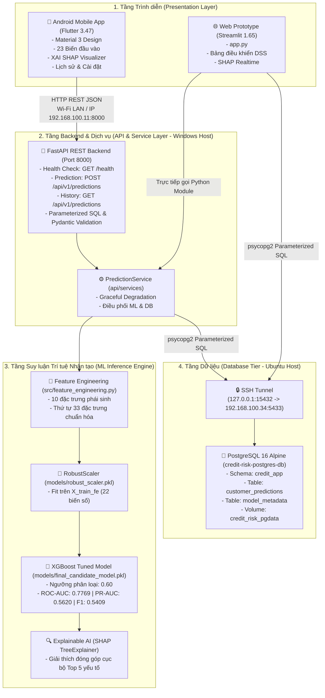
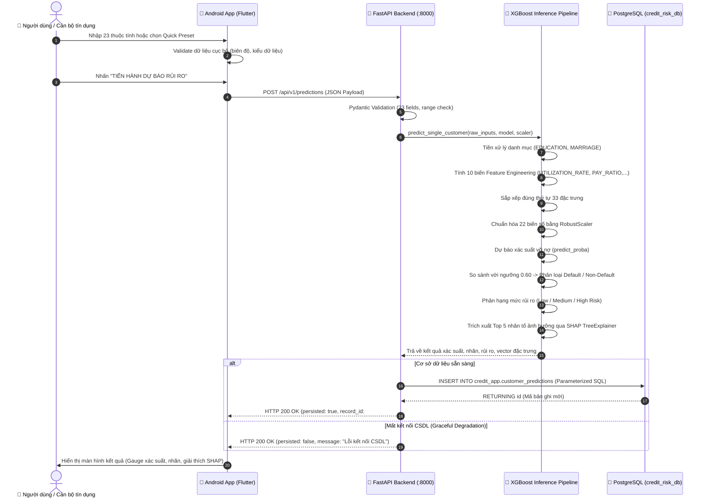

# KIẾN TRÚC HỆ THỐNG MOBILE APP FLUTTER & FASTAPI BACKEND
# (MOBILE & REST API SYSTEM ARCHITECTURE)

**Đề tài Khóa luận**: Nghiên cứu xây dựng mô hình Machine Learning trong đánh giá và dự báo rủi ro tín dụng khách hàng  
**Sinh viên thực hiện**: Nguyễn Trọng Thể — MSSV: 1150080117  
**Chuyên ngành**: Tin học Tài nguyên và Môi trường — Khóa 2022 – 2026 (K11)  
**Trường**: Đại học Tài nguyên và Môi trường TP.HCM (HCMUNRE)  

---

## 1. Tổng quan Kiến trúc Hệ thống (System Architecture Overview)

Hệ thống được phát triển theo mô hình **Kiến trúc Dịch vụ Đa Tầng (Multi-Tier Microservice Architecture)** phân tách hoàn toàn giữa giao diện di động (Presentation Tier), tầng dịch vụ và suy luận mô hình (Business & ML Inference Tier), và tầng lưu trữ bền vững (Data Persistence Tier).



---

## 2. Luồng Xử lý Dữ liệu và Dự báo (Sequence Flow)

Biểu đồ tuần tự dưới đây thể hiện toàn bộ quy trình khi người dùng nhập dữ liệu trên điện thoại Android, gửi tới FastAPI, thực hiện suy luận mô hình và lưu trữ vào PostgreSQL:



---

## 3. Đặc tả Hợp đồng Giao tiếp REST API (API Contract Specification)

### 3.1. Endpoint Kiểm tra Trạng thái (`GET /health`)

* **Mục đích**: Báo cáo trạng thái hoạt động độc lập của tiến trình API, mô hình ML và kết nối CSDL.
* **Response mẫu**:
```json
{
  "status": "healthy",
  "api_version": "1.0.0",
  "model_ready": true,
  "model_name": "XGBoost Tuned (Final Candidate)",
  "threshold": 0.60,
  "database_connected": true,
  "database_status_message": "Đã kết nối an toàn qua SSH Tunnel (Port 15432)"
}
```

### 3.2. Endpoint Dự báo Rủi ro (`POST /api/v1/predictions`)

* **Request Body (23 thuộc tính thô mẫu)**:
```json
{
  "LIMIT_BAL": 200000.0,
  "AGE": 35,
  "SEX": 2,
  "EDUCATION": 2,
  "MARRIAGE": 2,
  "PAY_0": 0,
  "PAY_2": 0,
  "PAY_3": 0,
  "PAY_4": 0,
  "PAY_5": 0,
  "PAY_6": 0,
  "BILL_AMT1": 25000.0,
  "BILL_AMT2": 22000.0,
  "BILL_AMT3": 20000.0,
  "BILL_AMT4": 18000.0,
  "BILL_AMT5": 15000.0,
  "BILL_AMT6": 12000.0,
  "PAY_AMT1": 3000.0,
  "PAY_AMT2": 2500.0,
  "PAY_AMT3": 2000.0,
  "PAY_AMT4": 2000.0,
  "PAY_AMT5": 1500.0,
  "PAY_AMT6": 1500.0
}
```

* **Response Body**:
```json
{
  "prediction_probability": 0.1189,
  "prediction_label": "Non-Default",
  "risk_level": "Low Risk",
  "threshold": 0.6,
  "model_version": "xgboost_tuned_v1",
  "record_id": 5,
  "persisted": true,
  "persistence_message": "Lưu thành công vào cơ sở dữ liệu với ID #5",
  "top_risk_factors": [
    {
      "feature": "PAY_0",
      "shap_value": -0.8421,
      "raw_value": 0.0,
      "direction": "↓ Risk"
    },
    {
      "feature": "UTILIZATION_RATE_SEPT",
      "shap_value": -0.4215,
      "raw_value": 0.125,
      "direction": "↓ Risk"
    }
  ]
}
```

### 3.3. Endpoint Truy vấn Lịch sử (`GET /api/v1/predictions?page=1&page_size=10`)

* **Query Parameters**: `page` (mặc định 1), `page_size` (mặc định 10, tối đa 50).
* **Sắp xếp**: Giảm dần theo thời gian tạo (`id DESC` / `created_at DESC`).
* **Response Body**:
```json
{
  "items": [
    {
      "id": 5,
      "created_at": "2026-10-29 22:15:30",
      "limit_bal": 200000.0,
      "age": 35,
      "default_probability": 0.1189,
      "prediction_label": "Non-Default",
      "risk_level": "Low Risk",
      "model_version": "xgboost_tuned_v1"
    }
  ],
  "total": 5,
  "page": 1,
  "page_size": 10
}
```

---

## 4. Ranh giới Bảo mật và Quyền hạn Dữ liệu (Security & Boundaries)

1. **Bảo mật Kết nối PostgreSQL**:
   * PostgreSQL không bao giờ được public trực tiếp ra Internet hoặc mạng Wi-Fi ngoài.
   * FastAPI trên Windows Host chỉ giao tiếp với PostgreSQL thông qua SSH Tunnel vòng lặp nội bộ `127.0.0.1:15432`.
   * Điện thoại Android chỉ được kết nối đến cổng HTTP `8000` của FastAPI, hoàn toàn không có quyền truy cập trực tiếp cổng `15432` hay `5433`.
2. **Ngăn chặn SQL Injection**:
   * Tất cả các thao tác thêm và đọc từ cơ sở dữ liệu đều sử dụng cú pháp Parameterized Query (`%(key)s` và `%s`), tuyệt đối không cộng chuỗi SQL thô.
3. **Phân quyền Cơ sở Dữ liệu tối thiểu (Least Privilege Principle)**:
   * Ứng dụng sử dụng tài khoản `app_streamlit` chỉ có quyền `INSERT` và `SELECT` trên schema `credit_app`, không có quyền `DROP TABLE`, `TRUNCATE`, hay can thiệp cấu trúc hệ thống.
4. **Bảo mật Biến môi trường**:
   * Toàn bộ mật khẩu, thông tin kết nối máy chủ được nạp từ file `.env` cục bộ. File này được loại trừ khỏi Git repository thông qua `.gitignore`.

---

## 5. Cấu hình Mạng cho Thiết bị Android Thật (Physical Device Connectivity)

* **Địa chỉ IP của Máy chủ Backend**: `192.168.100.11` (IP Wi-Fi của máy tính chạy FastAPI).
* **Cổng dịch vụ**: `8000`.
* **URL kết nối từ điện thoại**: `http://192.168.100.11:8000`.
* **Điều kiện bắt buộc**: Điện thoại Android và máy tính cùng kết nối vào cùng một Access Point Wi-Fi.
* **Cấu hình Cleartext Traffic**: Ứng dụng Android đã được kích hoạt `android:usesCleartextTraffic="true"` và cấp quyền `INTERNET`, `ACCESS_NETWORK_STATE` trong file `AndroidManifest.xml` để cho phép giao tiếp HTTP trong mạng LAN nội bộ.
